# Android Auto

The app works with Android Auto. In the car, you can browse your library, search, use voice commands, and control playback.

Android Auto always plays on the app's [Local Player](local-sendspin-player-settings.md). The phone plays the audio, and the car receives it from the phone. You cannot control other Music Assistant players (speakers, groups) from the car screen.

## Before You Start

Do these steps on the phone before you connect to the car:

1. [Connect the app to your Music Assistant server](app-settings.md).
2. [Enable the Local Player](local-sendspin-player-settings.md).
3. Open the app one time, so that it connects and signs in.

> **Important:** Enable the Local Player before you use Android Auto. If the Local Player is disabled, the car shows Music Assistant with one row only: **Local player is not enabled**. The car does not show your library, and you cannot start playback.

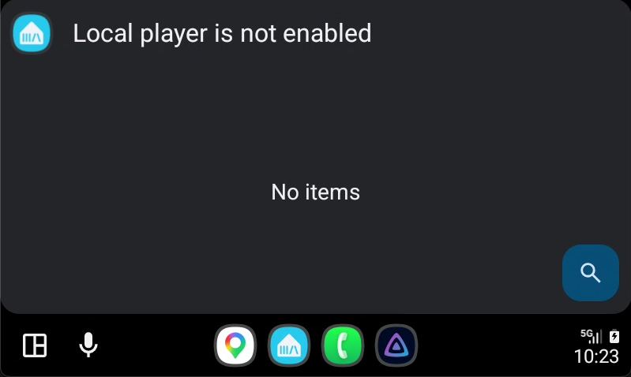

### If Music Assistant Is Not in the Car

The car shows apps from the Google Play Store automatically. If you installed the app from a different source (for example, an APK from GitHub), Android Auto hides it. To show the app:

1. On the phone, open the **Android Auto** settings.
2. Tap **Version and permission info** many times, until the developer mode dialog opens.
3. Accept the dialog.
4. Open the three-dot menu and tap **Developer settings**.
5. Turn on **Unknown sources**.
6. In the Android Auto launcher settings, make sure that **Music Assistant** is selected.

## Browsing in the Car

### Tabs

The car shows these tabs by default:

| Tab | Content |
|---|---|
| **Home** | The rows from the app [Home tab](home.md). |
| **Artists** | Your library artists. |
| **Albums** | Your library albums. |
| **Playlists** | Your library playlists. |
| **Podcasts** | Your library podcasts. |
| **Radio** | Your library radio stations. |
| **Audiobooks** | Your library audiobooks. |
| **AI Radio** | The AI Radio stations. This tab shows only if your server has the AI Radio provider and your user can use it. |

The car does not show the Tracks and Genres tabs. Long lists are not safe to scroll while you drive.

Android Auto shows a maximum of four tabs at the top of the screen. If you turn on more than four tabs, the car shows the first three tabs and a **More** tab. The **More** tab contains the other tabs. This is how Android Auto works, and the app cannot change it. To select the tabs that show first, change the tab order. Refer to [Tabs](#tabs-settings).

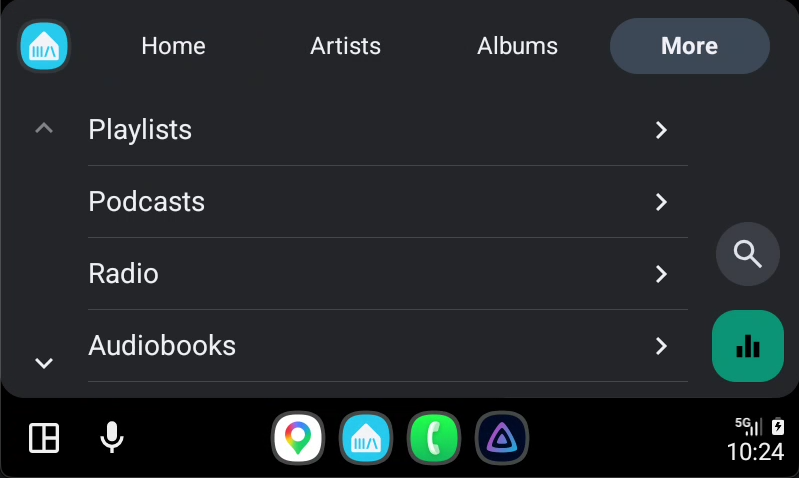

### Home Tab

The Home tab shows one folder for each row of the app Home tab. The car uses the same row order and the same hidden rows as the app. To change them, [customize Home](home.md#customizing-home) in the app. The car does not show the Shortcuts row, and it does not show genres.

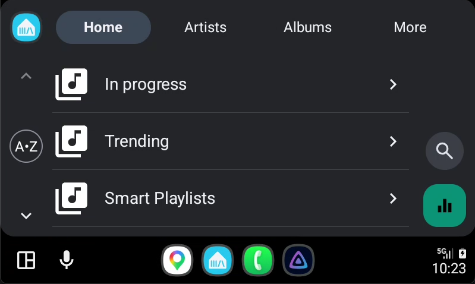

### Library Tabs

The **Artists**, **Albums**, **Playlists**, **Podcasts** and **Audiobooks** tabs each have four lists:

| List | Content |
|---|---|
| **Recent** | Items that you played last are at the top. |
| **Favorites** | Your favorite items only, in alphabetical order. |
| **New** | Items that you added last are at the top. For podcasts, podcasts with new episodes are at the top. |
| **By name** | All items, in alphabetical order. |

The **Audiobooks** tab shows each book as a separate item. It does not group books into series.

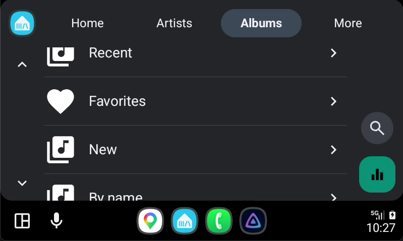

The **Radio** tab has one **Favorites** folder at the top. Below the folder, the tab shows all stations. Stations that you played last are at the top.

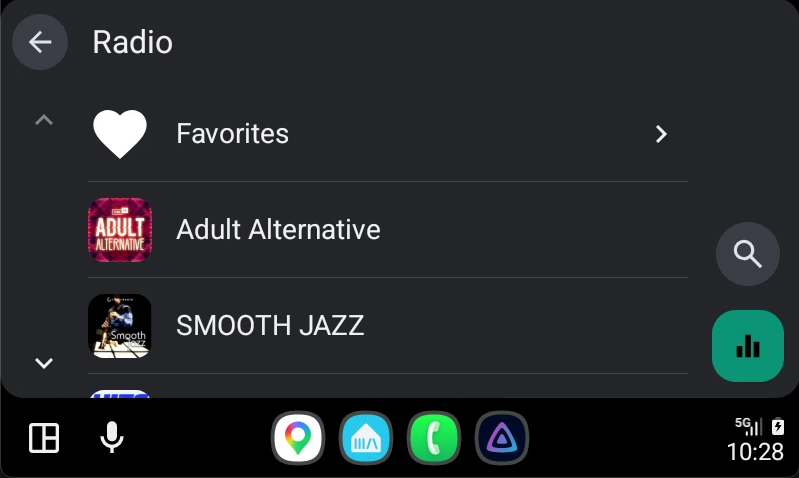

A heart (♥) before a name shows a favorite item.

### Opening an Item

Tap an artist, album, playlist or podcast to open it:

- An artist shows its albums.
- An album shows its tracks in track order.
- A playlist shows its tracks in playlist order.
- A podcast shows its episodes.

Action buttons show at the top of the list. By default, the buttons are **Play all** and **Add all to queue**. To change the buttons, refer to [Item Actions](#item-actions).

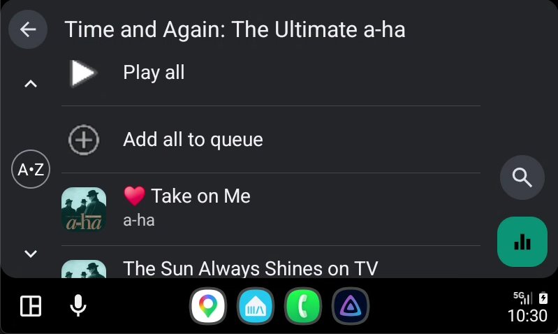

### Lists Refresh

The car keeps each list for 5 minutes, so that the car screen stays fast. A change on the server can show in the car after this time. When the app connects to the server again, the car loads all lists again.

## Searching in the Car

Tap the search icon and speak or type your search. The results show in these groups: **Tracks**, **Artists**, **Albums**, **Playlists** and **Radio stations**. Each group shows a maximum of five results. The results include items from your music sources, and not only items from your library.

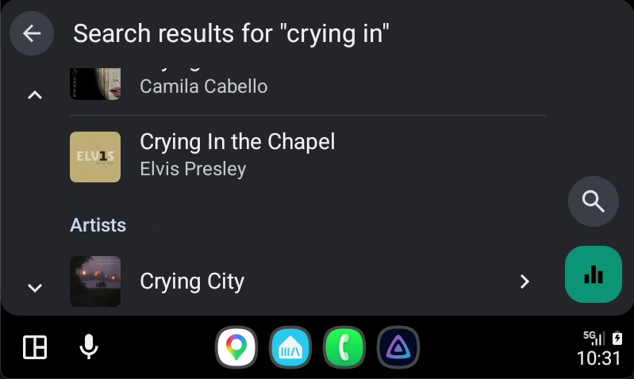

## Playing Music

### Tap an Item

When you tap a track, a radio station, a podcast episode or an audiobook, the app does the **Enqueue action** for that item type. By default, the action is **Play now**. **Play now** replaces the queue and starts playback immediately. To change the action, refer to [Item Actions](#item-actions).

### Now Playing Screen

The now playing screen shows the artwork, the title and the progress. You can use these controls:

- Play and pause.
- Next and previous.
- Move the progress bar to a different position.
- Open the queue and tap an item to play it.

The screen also shows more buttons. The buttons change with the type of the item:

| Item type | Buttons |
|---|---|
| Audiobooks and podcast episodes | Back 10 seconds, forward 30 seconds |
| All other items | **Shuffle**, **Favorite**, **Repeat** |

A button shows only if the item supports it. For example, the **Favorite** button shows only if you can add the item to your favorites. If Android Auto does not have space for all buttons, it puts some buttons into an overflow menu.

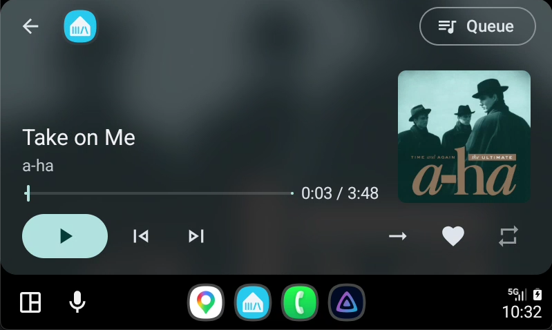
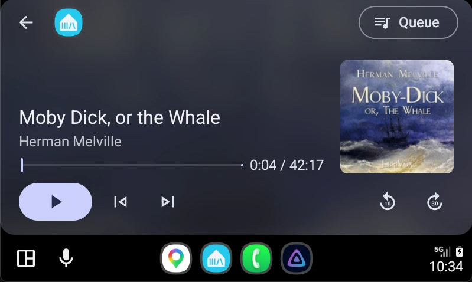
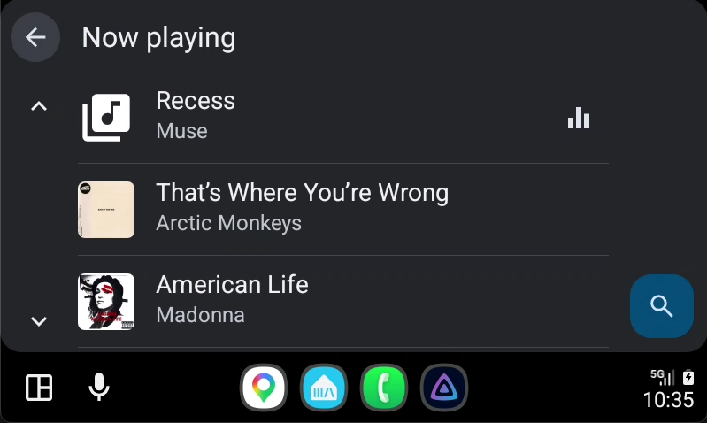

### Connection Problems

If the app loses the connection to the server, the car shows **Reconnecting…** or **Connection lost**. The app tries to connect again automatically. If the car shows an **Open app** button, tap it to open the app on the phone.

## Voice Commands

In the car, say "Hey Google" or push the voice button on the steering wheel. Then say the command, and end it with "on Music Assistant".

| You want to play | Example command |
|---|---|
| An artist | "Play Radiohead on Music Assistant" |
| An album | "Play the album OK Computer on Music Assistant" |
| A song | "Play Yesterday by The Beatles on Music Assistant" |
| A playlist | "Play my Workout playlist on Music Assistant" |
| A genre | "Play jazz on Music Assistant" |
| A podcast | "Play the Daily podcast on Music Assistant" |
| A radio station | "Play KEXP on Music Assistant" |
| Any music | "Play some music on Music Assistant" |

Results for each command:

- An artist plays all tracks of the artist, in shuffle mode.
- An album plays in track order.
- A podcast plays its latest episode.
- "Some music" plays your favorite tracks in shuffle mode. If you have no favorite tracks, the app plays your recently played tracks.

You can also say "pause", "next" or "resume" while Music Assistant plays.

> **Note:** If a different media app plays at that time, Google Assistant can send the command to that app. Select Music Assistant in the car first, or pause the other app. Then say the command again.

> **Note:** Voice commands always play on the Local Player.

## Car Settings

On the phone, open **Settings** and find the **Car (Android Auto / CarPlay)** section. The section shows only if the Local Player is enabled. The same settings apply to Android Auto and to CarPlay.

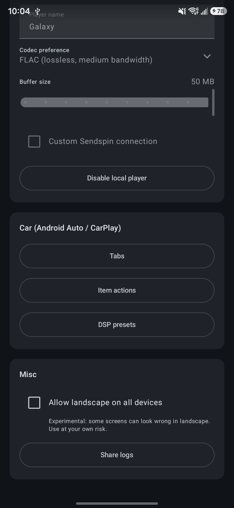

### Tabs {#tabs-settings}

Tap **Tabs** to select the tabs that the car shows and their order.

- Turn a tab on or off.
- Drag a tab to a different position.

Tap **Done** to keep the changes. If you turn on more than four tabs, the first three tabs show at the top of the car screen. The car shows the change the next time it loads the tab list. If the car does not show the change, open a different app in the car, and then open Music Assistant again.

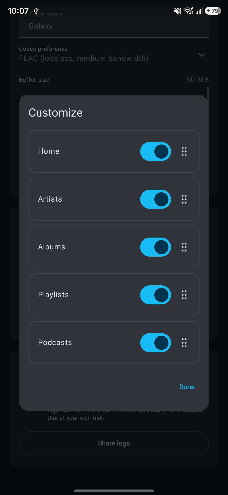

### Item Actions

Tap **Item actions** to open a list of action groups.

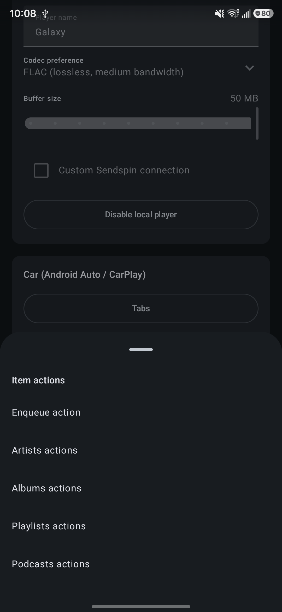

**Enqueue action** sets the action for a tap on a track, a radio station, a podcast episode or an audiobook. Select one action for each item type:

| Action | Result |
|---|---|
| **Play now** | Replaces the queue and starts playback. |
| **Add next and play** | Adds the item after the current item and plays it. |
| **Add next** | Adds the item after the current item. |
| **Add to queue** | Adds the item at the end of the queue. |
| **Start endless mix** | Starts a radio mode that plays similar music. |
| **Play from here** | Plays the album or the playlist, and starts at the track that you tap. |

Tap **Save** to keep the changes. The list shows only the actions that apply to the item type. **Play from here** is for tracks only. If you tap a track in the search results or in the Home tab, the app plays only that track.

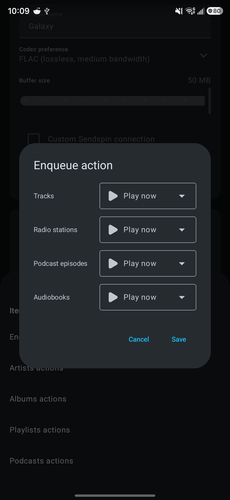

**Artists actions**, **Albums actions**, **Playlists actions** and **Podcasts actions** set the buttons that show at the top of an opened item.

- Turn a button on or off.
- Drag a button to a different position.

Tap **Done** to keep the changes. If you turn off all buttons, the car shows no buttons for that item type. The car shows these button names:

| Action in Settings | Button in the car |
|---|---|
| **Play now** | **Play all** |
| **Add next and play** | **Play all next** |
| **Add next** | **Add all next** |
| **Add to queue** | **Add all to queue** |
| **Start endless mix** | **Start endless mix** |

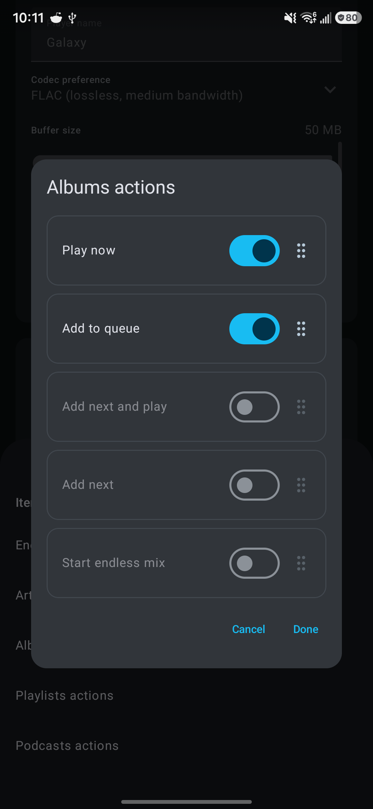

### DSP Presets

Tap **DSP presets** to change the DSP settings of the Local Player when the phone connects to the car, or disconnects from the car. Use the DSP presets, for example, to apply an equalizer for the car speakers.

- **On connect** sets the action when the phone connects to the car.
- **On disconnect** sets the action when the phone disconnects from the car.

For each one, select **Nothing**, **Disable DSP** or a DSP preset from your server. The change applies the next time the phone connects to the car or disconnects from the car.

If a preset is removed from the server, the app sets the selection to **Nothing** and shows a message.

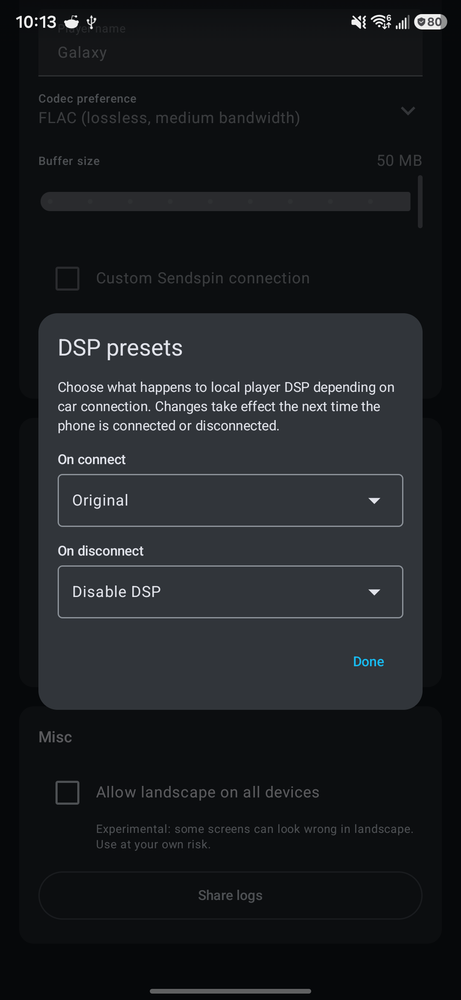

## Troubleshooting

| Problem | Solution |
|---|---|
| Music Assistant is not in the car. | If you installed the app from a different source than Google Play, turn on **Unknown sources**. Refer to [If Music Assistant Is Not in the Car](#if-music-assistant-is-not-in-the-car). |
| The car shows **Local player is not enabled**. | Enable the Local Player in the app. Then disconnect the phone from the car and connect it again. |
| The car shows a tab that you turned off, or does not show a new tab. | Open a different app in the car, and then open Music Assistant again. |
| A new item is not in the car list. | Wait 5 minutes. The car loads the list again. |
| A voice command plays in a different app. | Select Music Assistant in the car first, and then say the command again. |
| Playback does not start. | Open the app on the phone and make sure that it is connected to the server. |

To report a problem, open an issue on [GitHub](https://github.com/music-assistant/mobile-app/issues). Tell us what you did, what you expected, and what occurred.
