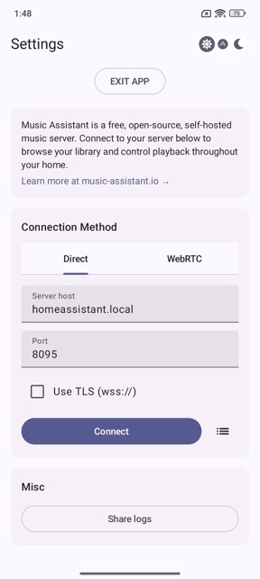

# Settings

When you open the app for the first time, the app shows the **Settings** screen. Use this screen to connect the app to your Music Assistant server. Later, open **Settings** from the **System** section of the side menu. See [Navigation](navigation.md).

## Connection Method

The app has two methods to connect to your Music Assistant server:

- **[Direct](connection-to-server-direct.md)** — Connect to your server on your local network, or through a remote connection that you set up.
- **[WebRTC](connection-to-server-webrtc.md)** — Connect from a remote location without a special network setup.

On the **Direct** tab, the app shows the **Servers on your network** list if it finds Music Assistant servers on your local network. Tap a server to connect to it.

> **Tip:** Tap the **list icon** next to the connect button to open your **Saved Connections**. Tap a saved connection to fill in its fields.

## Accent Color

The **Accent color** section sets the main color of the app. Tap a color to select it. **Default** keeps the standard colors of the app. **Wallpaper** uses the colors of your wallpaper. **Wallpaper** shows only on Android 12 or later.

## Misc

| Option | Description |
|---|---|
| **Allow landscape on all devices** | Lets the app use landscape on all devices. This option is experimental, so some screens can look wrong in landscape. |
| **Volume buttons control the selected player** | Android only. While the app is open and a different player than this device is selected, the volume buttons change the volume of that player. |
| **Share logs** | Shares the diagnostic logs of the app. Use the logs to find a connection problem or to report a bug. |
| **Share crash logs** | Shows only after a crash of the app. Shares the crash logs. Tap the **delete icon** next to it to delete the crash logs. |

## Additional Options

The top bar has three theme buttons:

- **Sun icon** — Use the light theme.
- **Auto icon** — Use the theme of your device settings.
- **Moon icon** — Use the dark theme.

Before you sign in, the screen also shows the **EXIT APP** button. Tap it to close the app.

