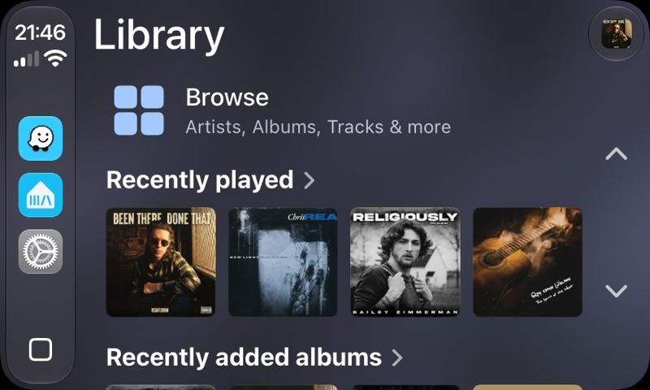
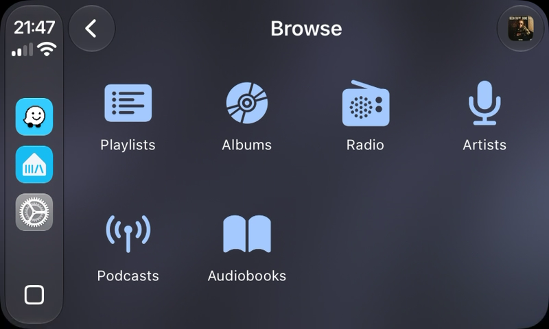
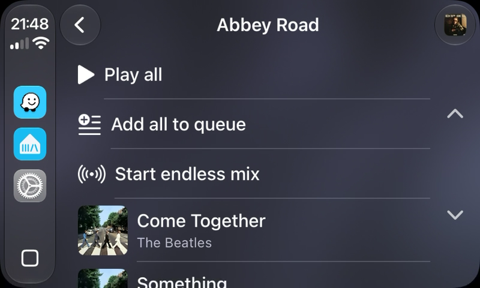
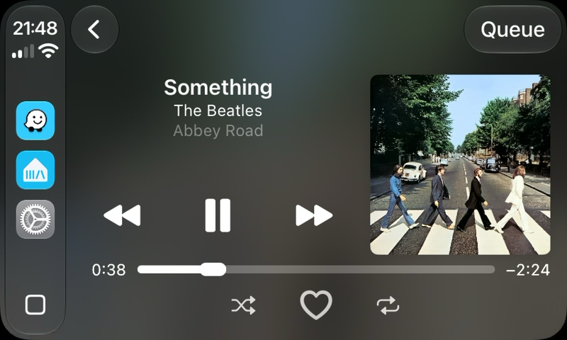
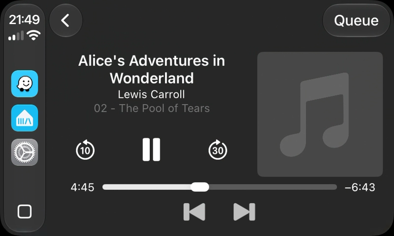
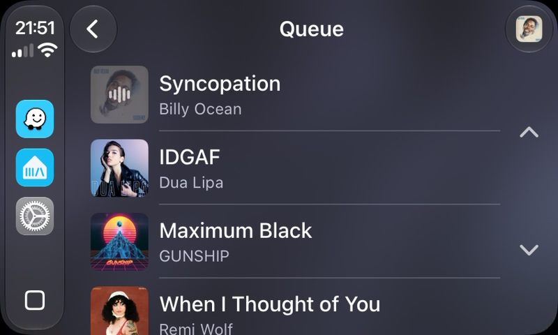
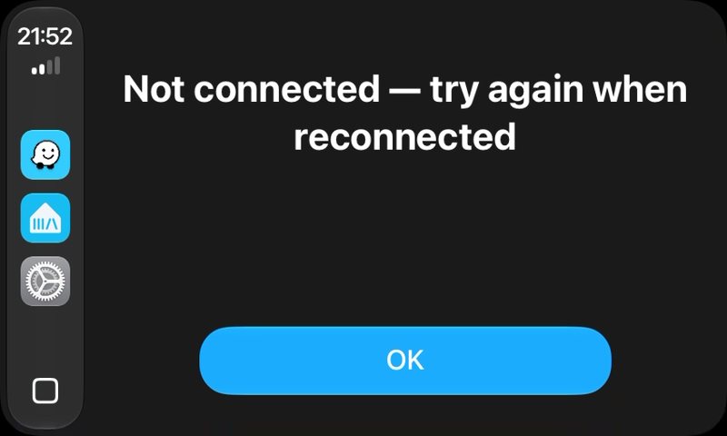
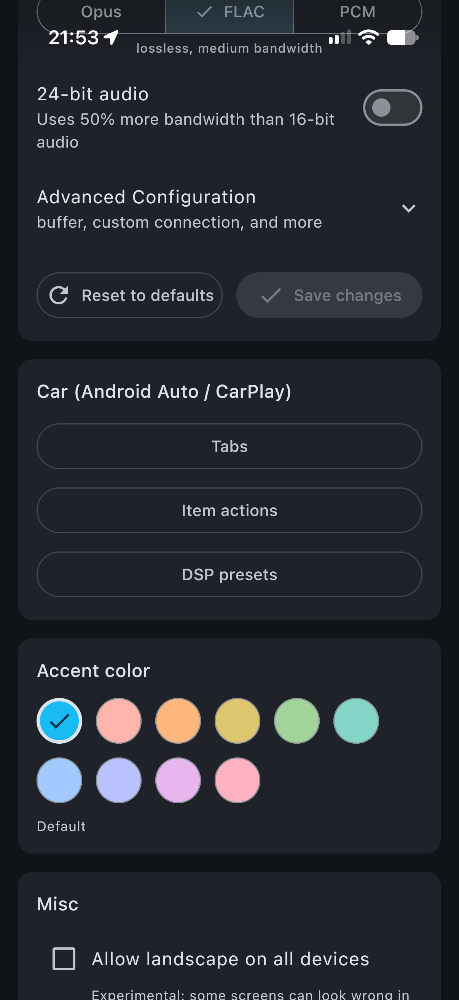

# Apple CarPlay

The app works with Apple CarPlay. In the car, you can browse your library, play recommendations, control playback, see the queue, and use Siri.

CarPlay always plays on the app [Local Player](local-sendspin-player-settings.md). The iPhone plays the audio, and the car receives it from the iPhone. You cannot control other Music Assistant players (speakers, groups) from the car screen. If the Local Player is in a group when you start playback in the car, the app removes it from the group first.

## Before You Start

Do these steps on the iPhone before you connect to the car:

1. [Connect the app to your Music Assistant server](app-settings.md).
2. [Enable the Local Player](local-sendspin-player-settings.md).
3. Open the app one time, so that it connects and signs in.

> **Important:** Enable the Local Player before you connect the iPhone to the car. The app checks the Local Player when the car connects. If the Local Player is disabled, CarPlay does not show your library, and you cannot start playback. If you enable the Local Player while the car is connected, disconnect the iPhone from the car and connect it again.

If Music Assistant is not on the CarPlay screen, open **Settings → General → CarPlay** on the iPhone. Select your car, tap **Customize**, and make sure that **Music Assistant** is on the list.

## The Library Screen

When you open Music Assistant in the car, the **Library** screen shows:

- A **Browse** row at the top. Tap it to open the library categories.
- One row for each recommendation row from your server, for example recently played items. Each row shows the artwork of up to eight items.

Tap an artwork in a recommendation row to play that item immediately. This tap always starts playback. It does not use the [Enqueue action](#item-actions) setting.

The recommendation rows come from your server. The app [Home tab](home.md) settings do not change these rows.

If the app loses the connection to the server, the screen shows **Disconnected — reconnecting…**. When the app connects again, the screen loads the rows again automatically.

## Browsing in the Car

### Categories

Tap **Browse** to open the categories. CarPlay shows these categories by default:

| Category | Content |
|---|---|
| **Artists** | Your library artists. |
| **Albums** | Your library albums. |
| **Playlists** | Your library playlists. |
| **Podcasts** | Your library podcasts. |
| **Radio** | Your library radio stations. |
| **Audiobooks** | Your library audiobooks. |
| **AI Radio** | The AI Radio stations. This category shows only if your server has the AI Radio provider and your user can use it. |

The car does not show the Tracks and Genres categories. Long lists are not safe to scroll while you drive.

To hide a category or to change the order, refer to [Tabs](#tabs). The **Home** tab setting does not apply to CarPlay, because the Library screen always shows the recommendation rows.

The icon color follows the accent color of the app. If you change the accent color, the car shows the new color the next time the iPhone connects to the car.

### Lists

Each category shows all items of that type in your library, in one list. CarPlay has no separate lists for recent, favorite or new items.

The **Audiobooks** list shows each book as a separate item. It does not group books into series.

The **AI Radio** list shows your AI Radio stations. If you have no stations, the list shows a message. Create a station in the Music Assistant web app.

### Opening an Item

Tap an artist, album, playlist or podcast to open it:

- An artist shows its albums. The title is **Albums by** and the artist name.
- An album shows its tracks.
- A playlist shows its tracks, and the other playable items that it contains.
- A podcast shows its episodes.

Action rows show at the top of the list. By default, the rows are **Play all** and **Add all to queue**. To change the rows, refer to [Item Actions](#item-actions).

After an action that starts playback, the car opens the Now Playing screen. After **Add next** or **Add all to queue**, the car stays on the list, so you can add more items.

### Searching

CarPlay has no search screen in the app. To find an item, use [Siri](#siri).

## Playing Music

### Tap an Item

When you tap a track, a radio station, a podcast episode or an audiobook, the app does the **Enqueue action** for that item type. By default, the action is **Play now**. **Play now** replaces the queue and starts playback immediately. To change the action, refer to [Item Actions](#item-actions).

### Now Playing Screen

The Now Playing screen shows the artwork, the title and the progress. You can use these controls:

- Play and pause.
- Next and previous.
- Move the progress bar to a different position, if your car supports it.

The screen also shows more buttons. The buttons change with the type of the item:

| Item type | Buttons |
|---|---|
| Music | **Shuffle**, **Like**, **Repeat** |
| Audiobooks and podcast episodes with chapters | Previous chapter, next chapter |
| Audiobooks and podcast episodes without chapters | No buttons |
| Radio stations | **Like** only, if your server can identify the song that plays now |

The chapter buttons need the chapter progress setting of your user in the Music Assistant web app. The setting is on by default. If you turn it off, the car shows no chapter buttons.

The **Like** button (♥) works like this:

| Current item | Button | Tap |
|---|---|---|
| A track that you like | Filled heart | Removes the like. |
| A track that you do not like yet | Outline heart | Adds the track to your favorites. |
| A radio station that plays a song that your server can identify | Outline heart | Adds the song that plays now to your favorites. |

The **Like** button shows only if your user can edit the library. The button does not show for audiobooks and podcast episodes.

### Queue

Tap **Queue** on the Now Playing screen to see the queue. The list starts at the item that plays now. For an audiobook, the list also shows the chapters of the current book.

- Tap an item to play it.
- Tap a chapter to go to that chapter.

The **Queue** button shows only if an item comes after the current item. CarPlay cannot move or remove items in the queue. Use the app on the iPhone to do this.

### Connection Problems

If you tap an item while the app is not connected to the server, the car shows **Not connected — try again when reconnected**. Tap **OK**, wait, and then try again.

If a list cannot load, it shows **Disconnected — reconnecting…**. The app tries to connect again automatically. The Library screen loads again when the connection is back. For other lists, go back and open the list again.

## Siri

Say "Hey Siri" or push the voice button on the steering wheel. Then say the command, and end it with "in Music Assistant".

| You want to play | Example command |
|---|---|
| An artist | "Play Radiohead in Music Assistant" |
| An album | "Play OK Computer by Radiohead in Music Assistant" |
| A song | "Play Yesterday by The Beatles in Music Assistant" |

The app searches your server for the best match and plays it on the Local Player.

You can also say "pause", "next", "previous" or "resume" while Music Assistant plays.

Siri learns from what you play in CarPlay. After you play items from CarPlay, Siri finds Music Assistant more easily.

> **Note:** You can say "I like this song" while Music Assistant plays. The app adds the song to your favorites. Siri can show an error message after the command, but the song is added. This is a known issue.

## Car Settings

On the iPhone, open **Settings** and find the **Car (Android Auto / CarPlay)** section. The section shows only if the Local Player is enabled. The same settings apply to Android Auto and to CarPlay.

### Tabs

Tap **Tabs** to select the categories that the **Browse** screen shows, and their order.

- Turn a category on or off.
- Drag a category to a different position.

Tap **Done** to keep the changes. The car shows the change the next time you open **Browse**. CarPlay ignores the **Home** entry.

### Item Actions

Tap **Item actions** to open a list of action groups.

**Enqueue action** sets the action for a tap on a track, a radio station, a podcast episode or an audiobook. Select one action for each item type:

| Action | Result |
|---|---|
| **Play now** | Replaces the queue and starts playback. |
| **Add next and play** | Adds the item after the current item and plays it. |
| **Add next** | Adds the item after the current item. |
| **Add to queue** | Adds the item at the end of the queue. |
| **Start endless mix** | Starts a radio mode that plays similar music. |
| **Play from here** | Plays the album or the playlist, and starts at the track that you tap. |

Tap **Save** to keep the changes. The list shows only the actions that apply to the item type. **Play from here** is for tracks in an album or a playlist only. In other lists, the app plays only the track that you tap.

**Artists actions**, **Albums actions**, **Playlists actions** and **Podcasts actions** set the action rows at the top of an opened item.

- Turn a row on or off.
- Drag a row to a different position.

Tap **Done** to keep the changes. If you turn off all rows, the car shows no action rows for that item type. The car shows these row names:

| Action in Settings | Row in the car |
|---|---|
| **Play now** | **Play all** |
| **Play shuffled** | **Play all shuffled** |
| **Add next and play** | **Add next and play** |
| **Add next** | **Add next** |
| **Add to queue** | **Add all to queue** |
| **Start endless mix** | **Start endless mix** |

**Play shuffled** is available for artists, albums and playlists only.

### DSP Presets

Tap **DSP presets** to change the DSP settings of the Local Player when the iPhone connects to CarPlay, or disconnects from CarPlay. Use the DSP presets, for example, to apply an equalizer for the car speakers.

- **On connect** sets the action when the iPhone connects to the car.
- **On disconnect** sets the action when the iPhone disconnects from the car.

For each one, select **Nothing**, **Disable DSP** or a DSP preset from your server. If a preset is removed from the server, the app sets the selection to **Nothing** and shows a message.

## Troubleshooting

| Problem | Solution |
|---|---|
| Music Assistant is not on the CarPlay screen. | On the iPhone, open **Settings → General → CarPlay**, select your car, and add **Music Assistant**. |
| CarPlay does not show your library. | Enable the Local Player in the app. Then disconnect the iPhone from the car and connect it again. |
| A category that you turned off still shows, or a new category does not show. | Go back to the Library screen and open **Browse** again. |
| The car shows **Not connected — try again when reconnected**. | Wait until the app connects to the server again, and then try again. |
| A list shows **Disconnected — reconnecting…**. | Go back and open the list again after the app connects. |
| Siri does not find Music Assistant. | Say "in Music Assistant" at the end of the command. Play some items from CarPlay, so that Siri learns about the app. |
| Playback does not start. | Open the app on the iPhone and make sure that it is connected to the server. |

To report a problem, open an issue on [GitHub](https://github.com/music-assistant/mobile-app/issues). Tell us what you did, what you expected, and what occurred.
