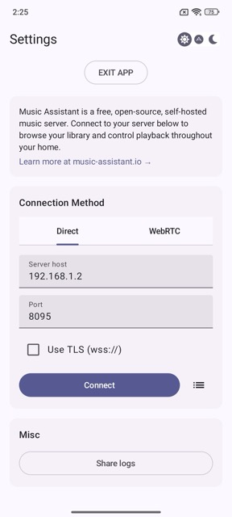
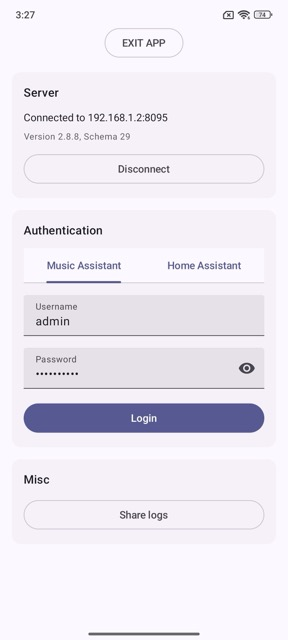
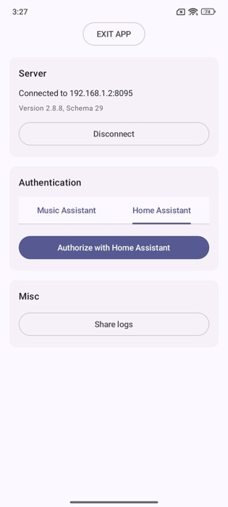
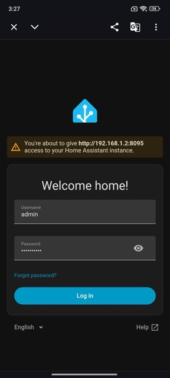

# Connect to Server using a Direct Connection Method

With a direct connection, the app connects to your server by its hostname, by its IP address, or through a reverse proxy or a tunnel.

Use the hostname if you can, because the hostname stays the same if the IP address of the server changes. If your server has a static IP address, the IP address works equally well.

If the app finds Music Assistant servers on your local network, it shows them in the **Servers on your network** list. Tap a server to connect to it. Then go to [Authentication](#authentication).

> **iOS:** iOS asks for permission to use your local network. Tap **Allow**, because without it the app cannot find or reach your server.

## Fill in the fields

| Field | Description |
|---|---|
| **Server host** | The hostname or IP address of your Music Assistant server, for example `homeassistant.local`*, `192.168.1.2`, `ma-app.duckdns.org` or `musicassistant.mydomain.com`. Enter only the hostname or the IP address, without a protocol, a port or a path. |
| **Base path (optional)** | The sub-path of the server, if a reverse proxy serves the server under a sub-path, for example `/ma`. Keep it empty in all other cases. |
| **SSL/TLS (wss://)** | Select this option if your server uses a secure (TLS) connection. |
| **Port** | The port of your Music Assistant server. The default is `8095`, and `443` with **SSL/TLS (wss://)**. |
| **Client certificate (mTLS)** | Shows only with **SSL/TLS (wss://)**. Use it only if your server or your reverse proxy needs a client certificate. |

\* `homeassistant.local` is the default hostname of your Home Assistant server. Use the hostname of your Home Assistant server if you installed Music Assistant as a Home Assistant App in HA OS.

If you select or clear **SSL/TLS (wss://)**, the app changes a default port to the default of the other mode. The app does not change a port that you typed.

> **Caution:** Do not use port `8123`. Port `8123` is the port of Home Assistant. Music Assistant uses its own port, `8095` by default.

Under the fields, the app shows the full address that it will use. Check this address before you connect.

Tap **Connect** to go to the next step. If the app has a saved sign-in for this server, the button shows **Connect with saved credentials**.

> **Known issue (iOS):** Artwork can be missing in some setups, for example with a mesh VPN such as Tailscale.
>
> iOS App Transport Security (ATS) blocks image requests to insecure hosts, but it lets requests go to the local network. Over Tailscale and similar VPNs, the server is a remote host for the phone, so ATS blocks the requests.

### Client certificate (mTLS)

On Android, tap **Choose** to select a certificate that you installed on your device. On iOS, tap **Choose** to import a `.p12` file, then enter its password. Tap **Clear** to stop the use of the certificate.

### Connecting over the internet without exposing the MA port

You can keep the Music Assistant port (`8095` by default) closed to the internet. Put your server behind a reverse proxy or a tunnel, for example a Cloudflare Tunnel, Nginx or Traefik. The proxy forwards the traffic to Music Assistant, so only the proxy port must be open.

In that setup, fill in the fields like this:

| Field | Value |
|---|---|
| **Server host** | Your domain, for example `musicassistant.mydomain.com`. Do not add a port. |
| **Base path (optional)** | The sub-path of your proxy, if the proxy serves Music Assistant under a sub-path. |
| **SSL/TLS (wss://)** | Select it if your proxy uses a secure (TLS or HTTPS) connection. Clear it for plain HTTP. |
| **Port** | The external port of your proxy, for example `443` for HTTPS, `80` for HTTP, or your own port. |

> **Note:** A browser does not need a port for `443` or `80`, but the app does. Enter the port that your proxy uses externally.

The app needs no specific reverse proxy, protocol or port. Use the method that fits your setup.

## Authentication

After you connect, the app asks you to sign in. Select one of these methods:

| Authentication method | Description |
|---|---|
| **Music Assistant** | Sign in with the username and the password of a Music Assistant user. |
| **Music Assistant** with a token | Tap **Use a token instead**, then paste an **Access token**. Create a long-lived token on your profile page in the Music Assistant web interface. |
| **Home Assistant** | Tap **Authorize with Home Assistant** to sign in with Home Assistant. The Home Assistant user must have a link to the Music Assistant server. |

The **Home Assistant** tab shows only if the server offers Home Assistant sign-in.

After you sign in, set up the [Local Player](local-sendspin-player-settings.md), or [start to use the app](navigation.md).
