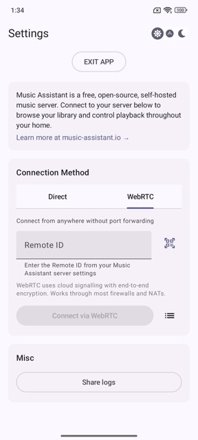
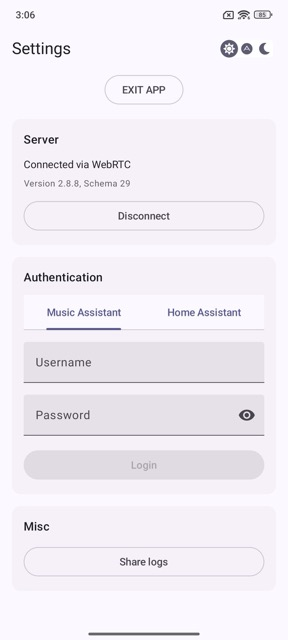
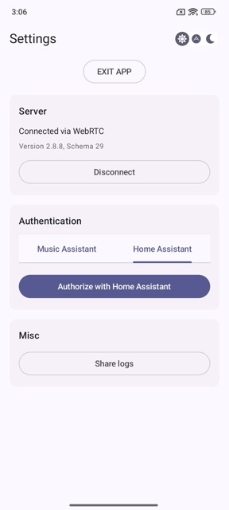
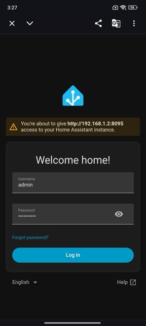

# Connect to Server using WebRTC

> **Note:** The WebRTC connection of the app is experimental. For the best experience, use a [direct connection method](connection-to-server-direct.md).

With WebRTC, the app connects to your Music Assistant server from any location without a special network setup. A WebRTC connection can be slower and less reliable than a direct connection.

Before you connect, make sure that the <a href="https://www.music-assistant.io/settings/remote-access/" target="_blank">Remote Access Settings on your Music Assistant Server</a> are correct.

## Fill in the fields

1. Select the **WebRTC** tab.
2. Enter the **Remote ID** of your Music Assistant server, for example `G7M5K9LM-1SXVF-NVAL6-F3S7BV36`*.
3. Tap **Connect via WebRTC**.

To fill in the **Remote ID** automatically, tap the **QR code icon** and scan the QR code of your server.

\* `G7M5K9LM-1SXVF-NVAL6-F3S7BV36` is not a real Remote ID. Use the Remote ID of your server.

If the app has a saved sign-in for this server, the button shows **Connect with saved credentials**.

## Authentication

After you connect, the app asks you to sign in. Select one of these methods:

| Authentication method | Description |
|---|---|
| **Music Assistant** | Sign in with the username and the password of a Music Assistant user. |
| **Music Assistant** with a token | Tap **Use a token instead**, then paste an **Access token**. Create a long-lived token on your profile page in the Music Assistant web interface. |
| **Home Assistant** | Tap **Authorize with Home Assistant** to sign in with Home Assistant. The Home Assistant user must have a link to the Music Assistant server. |

The **Home Assistant** tab shows only if the server offers Home Assistant sign-in.

After you sign in, set up the [Local Player](local-sendspin-player-settings.md), or [start to use the app](navigation.md).
