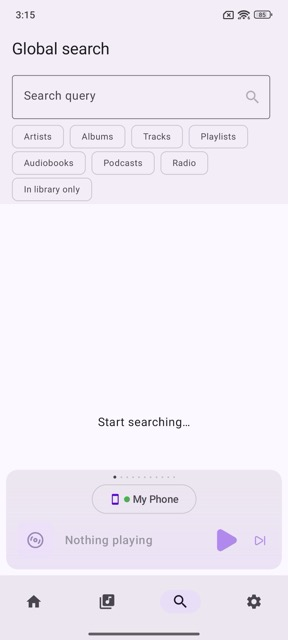
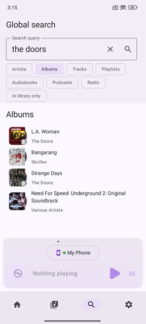
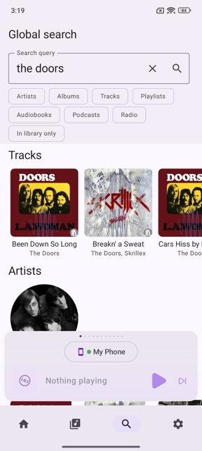

# Search

The **Search** page searches your library and your music sources. Music Assistant sends the search to all selected music sources at the same time. So a search can take longer than a quick search in your [library](library.md).

The speed of a search depends on your music sources and on their rate limits.

## Starting a Search

1. Type your search query.
2. Press the search key on your keyboard.

The results show one row for each media type.

## Filters

Tap the **filter icon** to open the **Filters** sheet. Set the filters, then tap **Apply**. The search starts again with the new filters. Tap **Reset filters** to clear all filters.

- **Media type** — Select one or more media types. If you select none, the search includes all media types. Fewer media types give faster results, because the server makes fewer requests to your music sources.
- **Music sources** — Select the sources to search: **Library** and your music sources. If you select none, the search includes all sources. Your server keeps this choice for your user. This filter needs server 2.10 or later.
- **In library only** — On a server before 2.10, this switch shows instead of **Music sources**. Turn it on to search your library only.

## Recent Searches

Before a search starts, the page shows your **Recent searches** that contain the text of the search field. Tap a recent search to run it again.

A query becomes a recent search when you open one of its results. Your server keeps the recent searches for your user, so the Music Assistant web app shows the same list.
