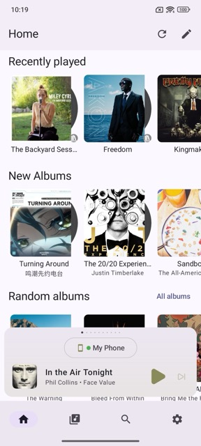
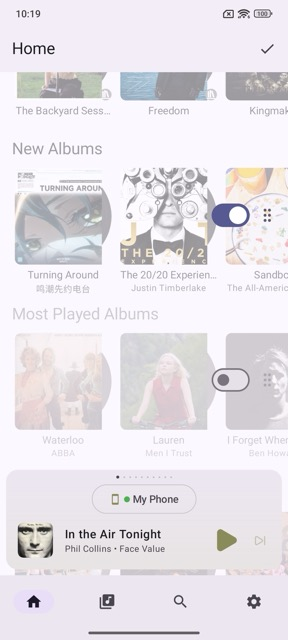
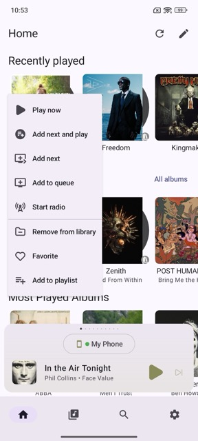
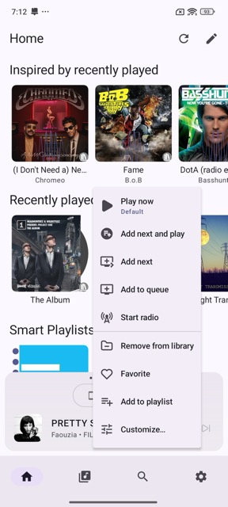
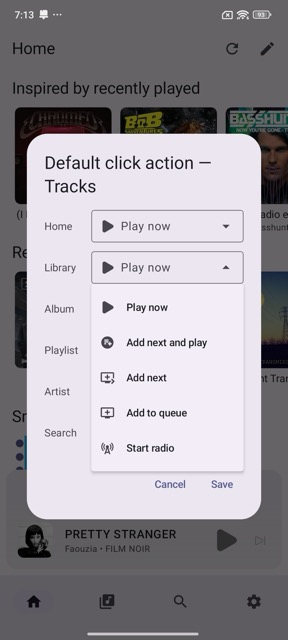

# Discover

The **Discover** page shows the rows of the **Discover** view of Music Assistant. The rows come from your Music Assistant server. The page also shows a **Shortcuts** row if you have shortcuts in the Music Assistant web app.

The app has its own [Players Pager](players-pager.md) to control your Music Assistant players.

## Refreshing Discover

Tap the **refresh icon** in the top right corner to load the rows again from your server.

## Customizing Discover

1. Tap the **pencil icon** in the top right corner.
2. Turn off the switch of each row that you want to hide.
3. Drag a row by its handle to move it.
4. Tap the **done icon** to save the changes.

At least one row must stay visible. The app saves the changes on this device only.

## Rows of tracks, episodes and radio stations

A row that holds only tracks, podcast episodes or radio stations shows its items as a list. Each column of the row holds two items. Other rows show one line of tiles.

## Interacting with Items

Tap an item to open its [item details page](item-details.md). A tap on a track, a podcast episode or a radio station starts the default action instead. The default action is **Play now**, which replaces the queue and starts playback.

Long-press an item to open a menu with more actions. The actions in the menu change with the item type.

### Customizing the default action

You can set a different default action for each item type and for each place in the app.

1. Long-press a track, a podcast episode or a radio station.
2. Tap **Customize…** at the bottom of the menu.
3. In the **Default click action** dialog, select an action for each place.
4. Tap **Save**.

The dialog shows only the places where the item type can show. The places are **Discover**, **Library**, **Browse**, **Album**, **Playlist**, **Artist**, **Search** and **Podcast**.

For an album, an artist, a playlist, a podcast or an audiobook, the dialog sets the action of the play button on the [item details page](item-details.md). This place has the name **Play button**.

