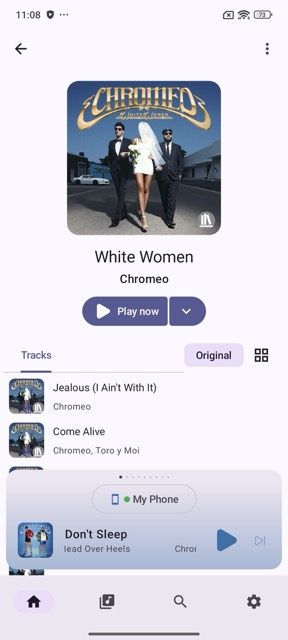
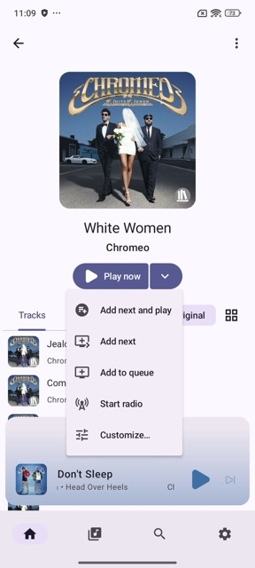
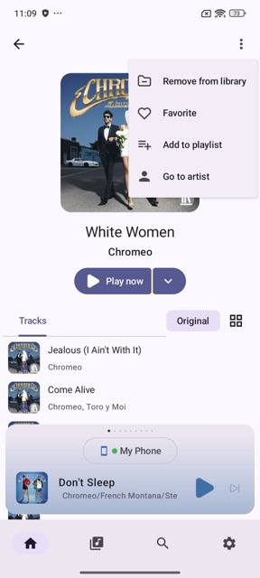
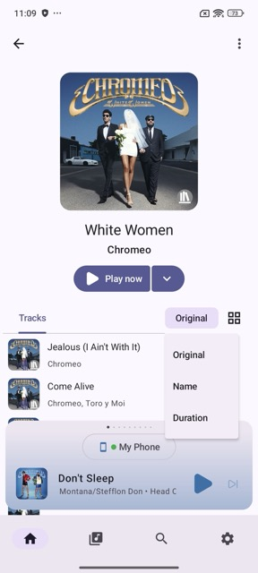
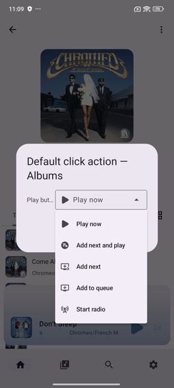

# Item Details

Tap an item in [Home](home.md), [Library](library.md) or [Global Search](global-search.md) to open its **item details** page. An artist, an album, a playlist, a podcast, a podcast episode, an audiobook, a series, a radio station and a genre each have a page. The page shows the artwork, the title, the play button and the actions of the item. The content of the page changes with the type of the item.

## Playing an Item

Tap **Play now** to replace the queue and start the item immediately.

Tap the **dropdown arrow** next to **Play now** to see more play options:

| Option | Result |
|---|---|
| **Add next and play** | Adds the item after the current item and plays it. |
| **Add next** | Adds the item after the current item. Playback continues. |
| **Add to queue** | Adds the item at the end of the queue. |
| **Add next and replace the rest** | Adds the item after the current item and removes all items after it. |
| **Play shuffled** | Replaces the queue and plays the item in random order. |
| **Play from beginning** | Plays a podcast episode from the start, and not from the resume point. |
| **Start endless mix** | Starts an endless mix of music that is similar to the item. |
| **Customize…** | Opens the **Default click action** settings. Refer to [Customizing the Default Click Action](#customizing-the-default-click-action). |

The menu shows only the options that apply to the item:

- **Play shuffled** shows for an album, an artist, a playlist, a genre and an audiobook series. The server must have schema version 52 or higher.
- **Play from beginning** shows for a podcast episode that you started or finished. The server must have schema version 40 or higher.
- **Start endless mix** does not show for a dynamic playlist.

## Description and Facts

Under the title, the page shows the facts of the item in one line. The line can contain these facts:

- The album type and the year of an album.
- The number of tracks and the total playing time. A dynamic playlist does not show these facts.
- The playing time of a podcast episode.
- The publisher of an audiobook.
- The music services that have a library item.

A playlist also shows its owner. From server 2.11, a Music Assistant playlist shows its access instead. The line shows **Personal** or the owner, the users that can see the playlist, and **Collaborative** if other users can edit it.

A library artist and a library album show their genres as chips. Tap a chip to open the genre.

The page shows the long text of the item under the header:

- The **Biography** of an artist.
- The **Review** of an album, or its **Description**.
- The **Description** of a playlist, a podcast or an audiobook.

If the text is long, the page shows 3 lines and **More**. Tap the text to open the full text in a sheet. Tap a link in the text to open it in the browser.

## Additional Actions

Tap the **three-dot menu** in the top right corner to see more actions. The actions change with the type of the item.

| Action | Shows when |
|---|---|
| **Add to library**, **Remove from library** | The item is not a genre or a series, and you have the `library.write` scope. |
| **Favorite**, **Unfavorite** | The item is in your library, and you have the `library.write` scope. |
| **Dislike**, **Remove dislike** | The same as **Favorite**. The server must be version 2.11 or later. |
| **Add to playlist** | The item can go into a playlist, and you have the `library.write` scope. |
| **Go to artist**, **Go to album**, **Go to podcast** | The item has an artist, an album or a podcast. |
| **Similar artists** | The item is an artist. |
| **Lyrics** | The item is a track that has lyrics. |
| **Transcript** | The item is a podcast episode that has a transcript. The server must be version 2.11 or later. |
| **Refresh item** | Refer to [Refreshing an Item](#refreshing-an-item). |
| **Find on your music services** | Refer to [Refreshing an Item](#refreshing-an-item). |
| **Export playlist** | The item is a playlist in your library. Refer to [Managing Playlists](playlists.md#exporting-a-playlist). |
| **Copy play link** | The item is playable. Refer to [Copy a Play Link](deep-links.md#copy-a-play-link). |
| **Dynamic colors** | Always. |

### Refreshing an Item

**Refresh item** loads the item again from its music services. **Find on your music services** shows instead if no music service has the item. The server then searches for a substitute.

- **Refresh item** needs the `library.manage` scope.
- **Find on your music services** needs the `library.manage` scope. From server 2.11, the `library.write` scope is enough.

The server can need some minutes to refresh an item. While the server works, the top bar shows a progress indicator. You can close the page. The indicator shows again when you open the page again.

## Going to the Artist

On an album, tap the artist names below the album title to open the artist. If the album has more than one artist, a dialog opens. Select the artist that you want to open. The **Go to artist** action in the three-dot menu does the same thing.

## Artist Page

An artist page shows its content in rows. Tap **View all** to see all items of a row.

| Row | Content |
|---|---|
| **Top tracks** | The top tracks of the artist. |
| **Albums** | The albums of the artist. |
| **Singles & EPs** | The singles and the EPs of the artist. |
| **Appears on** | The albums of other artists that contain the artist. |
| **Discography** | All releases of the artist. |

**Appears on** and **Discography** show only for a library artist. The server must be version 2.11 or later.

The **Discography** row can contain a release that no music service has. The row shows this release dimmed, and you cannot play it. The menu of this release contains **Add to library** only.

An audiobook author or narrator has two different rows: **In library** and **All audiobooks**.

## Tracks, Episodes, or Chapters

The list on the page changes with the type of the item:

| Item | List |
|---|---|
| Album | The tracks. |
| Playlist | The tracks. |
| Podcast | The episodes. |
| Podcast episode | The **Other episodes** of the podcast. |
| Audiobook | The chapters. |
| Series | The audiobooks of the series. |
| Genre | The artists and the albums. |

Long-press a track or an episode in the list to see its actions. In an album, a playlist or a podcast, the menu also contains **Play album from here**, **Play playlist from here** or **Play from here to latest**.

### Sorting

Tap the **sort order button** to change the order of items in the list. The options change with the content type.

### Toggle View Type

Use the **grid icon** next to the sort order button to change between the list view and the grid view.

## Podcast Episode Page

The page of a podcast episode shows the name of the podcast, the played state and the playing time. Tap the name of the podcast to open the podcast.

- **About this episode** shows the description of the episode.
- **Other episodes** shows the other episodes of the podcast, in the sort order of the podcast page.
- **Transcript** in the three-dot menu shows the transcript of the episode. The server must be version 2.11 or later.

## Selecting Multiple Items

On an album, an artist, a playlist, a podcast or an episode page, you can do one action on many tracks or episodes.

1. Long-press a track or an episode.
2. Tap **Select multiple**.
3. Tap the other items that you want to select. Tap a selected item again to remove it from the selection.
4. Tap **Actions for selected items** in the top bar.
5. Select an action.

To select all items that the page shows, tap **Select all**. To stop, tap **Cancel selection** or go back.

The actions menu contains these actions:

- **Play now**, **Add next and play**, **Add next**, **Add to queue** and **Add next and replace the rest**. The app sends the items in the order that you selected them.
- **Add to playlist**. This action needs the `library.write` scope.
- **Remove from playlist**. This action shows only on a playlist that you can edit. The app asks for a confirmation before it removes the items.

After an action, the selection stops.

## Customizing the Default Click Action

You can change the default action of a tap for each item type. Tap the **dropdown arrow** next to **Play now**, and then select **Customize…**. The **Default click action** settings open.

Select a different default action, for example **Add next and play**, **Add to queue** or **Play shuffled**. The action applies when you tap an item of that type. The options change with the content type.

