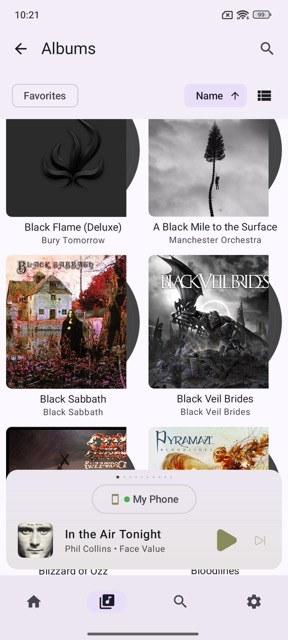
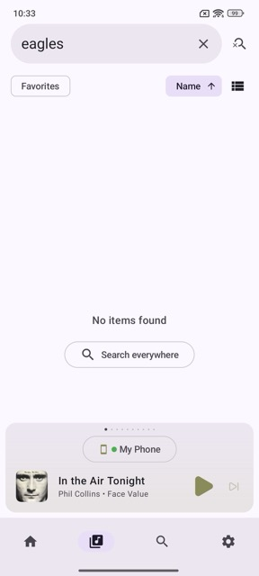
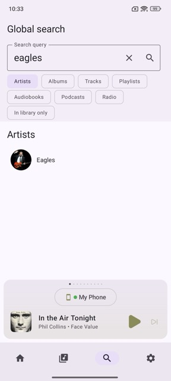
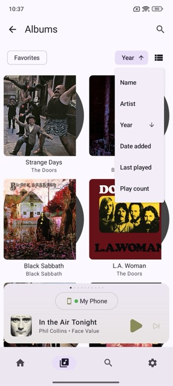
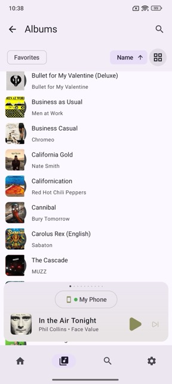
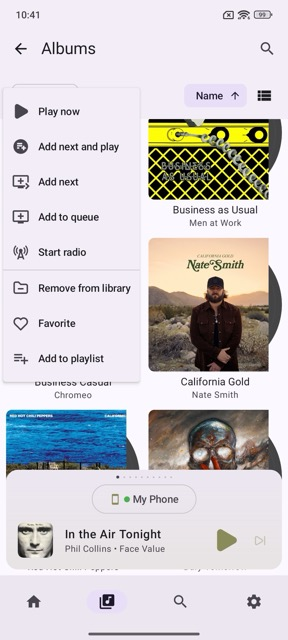
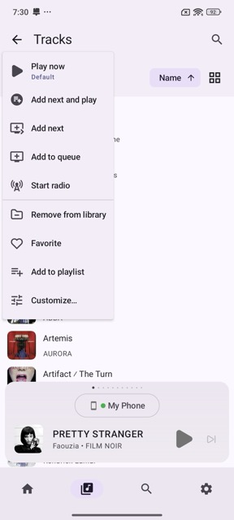
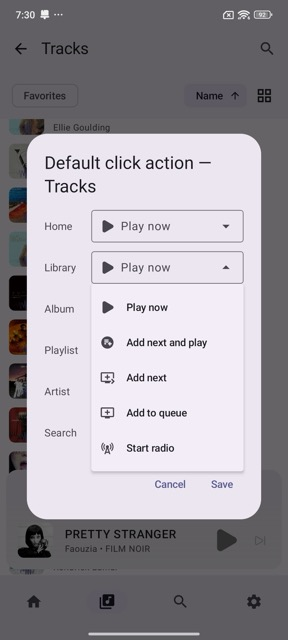

# Library

Your Music Assistant library is the music, the podcasts and the audiobooks that you added to Music Assistant. The **Library** section of the side menu has one entry for each category: **Artists**, **Albums**, **Tracks**, **Playlists**, **Audiobooks**, **Podcasts**, **Radio** and **Genres**. To hide or move a category, see [Navigation](navigation.md#customizing-the-side-menu).

Tap a category to open its list. The list shows all items of that type in your library.

## Quick Search

Tap the **search icon** in the top bar to search the list for a name.

If no item matches, tap **Search everywhere**. The app opens [Search](global-search.md) with your query and the filter of the list type.

> **Example:** Search for "eagles" in the **Artists** list. Then tap **Search everywhere**. **Search** opens with "eagles" and the **Artists** filter.

## Filters

Tap the **filter icon** in the top bar to open the **Filters** sheet. The icon shows in color while a filter is active. Set the filters, then tap **Apply**. Tap **Reset filters** to clear all filters.

The sheet shows these filters:

| Filter | Lists | Description |
|---|---|---|
| **Favorites** | All lists | Shows only your favorites. |
| **Music sources** | All lists except **Genres** | Shows only the items of the selected music sources. The filter shows only if more than one source has items of the list type. |
| **Genres** | All lists except **Genres** | Shows only the items of the selected genres. |
| **Album artists only** | **Artists** | Shows only the album artists. |
| **Album types** | **Albums** | Shows only the selected album types, for example **Single** or **EP**. |
| **Show** | **Audiobooks** | Shows the books, the **Authors** or the **Narrators**. The authors and the narrators show only if your library has them. |
| **Show genres** | **Genres** | **Default**, **Non-empty only** or **All**. |
| **Content type** | **Genres** | Shows the genres of **Music**, **Podcasts** or **Audiobooks**. |
| **Media type** | **Genres** | Shows when **Content type** is **Music**. |

The app keeps the filters of each list on this device.

## Sort

Tap the **sort chip** under the top bar to select the sort order. Tap the selected order again to change the direction.

The sort options change with the list. On server 2.11 or later, the server gives the sort options.

## Toggle View Type

Tap the **view mode** button to change between a grid and a list. The app keeps this setting for each list type.

## Audiobook Series

The **Audiobooks** list has a **Group series** button. Turn it on to show each series as one item. Tap a series to see its books.

## Playlists

The **Playlists** list has the **Add new** and **Import** buttons. For more information, see [Managing Playlists](playlists.md).

## Browse

**Browse** is in the **Explore** section of the side menu. It shows the folders of your music sources, as the server gives them. Tap a folder to open it.

From server 2.9, the top level of **Browse** also shows the input sources of the server plugins. Tap an input source to play it.

## Interacting with Items

Tap an item to open its [item details page](item-details.md). A tap on a track or a radio station starts the default action instead. The default action is **Play now**, which replaces the queue and starts playback.

Long-press an item to open a menu with more actions. The actions in the menu change with the item type.

To change the default action, see [Customizing the default action](home.md#customizing-the-default-action).

