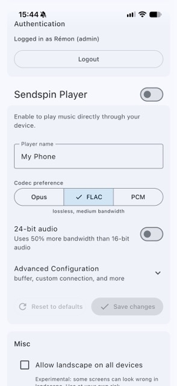
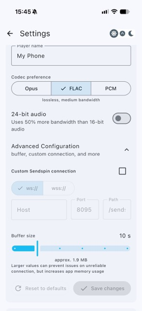
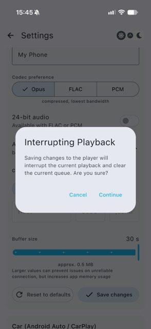
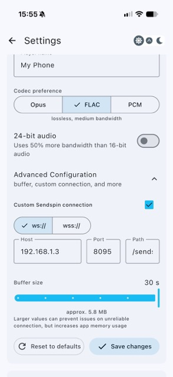

# Setting up the Local Player (optional)

You can use the app purely as a remote control for external players, with the local player disabled. Or you can configure it as a Sendspin client to play music directly through your device.

## Enabling the Local Player

In **Settings**, scroll to the **Sendspin Player** section. Use the switch in the section header to turn the player on or off.

You can change these settings when the player is on or off:

- **Player name** — The name that shows in Music Assistant (default: My Phone).
- **Codec preference** — The audio codec for the stream. See [Codec Preference](#codec-preference) below.
- **24-bit audio** — Streams 24-bit instead of 16-bit audio. This uses about 50% more bandwidth. Only available with FLAC or PCM; the switch is disabled when Opus is selected. See [24-bit Audio](#24-bit-audio).
- **Advanced configuration** — Tap this row to show or hide the settings that follow:
  - **Custom Sendspin connection** — Keep this setting off if your setup does not need a custom connection. See [Custom Sendspin Connection](#custom-sendspin-connection).
  - **Buffer size** — The maximum buffer size for the current stream, set with a slider (default: 10 s). The buffer helps the player continue through short network interruptions. It is not for offline playback, and it does not load the next queue items in advance. Larger values can prevent issues on an unreliable connection, but a larger buffer uses more app memory. The slider shows the approximate memory the buffer needs for the selected length, codec and bit depth (for example, about 1.9 MB at 10 s with FLAC, or about 0.5 MB at 30 s with Opus).

The advanced configuration opens automatically if one of its settings is not at the default value.

## Saving Changes

Tap **Save changes** to apply your changes. Tap **Reset to defaults** to apply the default values. Both buttons are only active when there is something to save or reset.

If the player is playing audio, the app shows an **Interrupting Playback** dialog first. Saving changes to the player interrupts the current playback and clears the current queue, so tap **Continue** to proceed or **Cancel** to keep playing.

> **Good to know:** The app's built-in Local Player is designed to be a private player for a personal music experience. It plays music on your device, for you, while you're using it. This is different from the other players Music Assistant supports (like speakers), which stay on and available all the time. The Local Player isn't meant to work that way, so you can't find or control it from other apps or devices.

> It's hidden by default in the Music Assistant Web UI, but visible under Music Assistant > Settings > Players as long as it's registered to the server. Registration only happens automatically while the Local Player is enabled and the app is active and connected to the server. As soon as the app goes inactive or loses that connection, the player is de-registered and its settings become uneditable.

> **Note:** de-registration can take a moment after the app becomes inactive or loses its connection. This delay is one of the reasons the player is hidden by default on other interfaces: during that window, manual actions taken from those interfaces (like the Web UI or another device) may not come through correctly in the app, even though the player might still appear active there.

## Codec Preference

The codec controls how audio is compressed and streamed from your Music Assistant server to the app. Choose based on your network conditions and how much audio quality matters to you. The selected option shows a short description underneath (for example, "lossless, medium bandwidth").

- **Opus** *(Compressed, lowest bandwidth)* — A lossy format that uses the least data. Audio quality is good but not lossless. Best for mobile data connections, slower Wi-Fi, or when bandwidth is a concern. 24-bit audio is not available with Opus.

- **FLAC** *(Lossless, medium bandwidth)* — Streams audio in full quality without any loss, using a moderate amount of bandwidth. Recommended over PCM for most setups — identical quality to PCM, with less network load.

- **PCM** *(Lossless, high bandwidth)* — Streams uncompressed, lossless audio but uses considerably more bandwidth than FLAC for identical quality. Only use this if your device or firmware has trouble playing FLAC files.

## 24-bit Audio

Turn on **24-bit audio** to stream at 24-bit instead of 16-bit depth. This uses about 50% more bandwidth than 16-bit audio, and it also increases the memory needed for the buffer.

This option is only available with the **FLAC** and **PCM** codecs. When **Opus** is selected, the switch is disabled and shows "Available with FLAC or PCM".

## Custom Sendspin Connection

If the app cannot reach your Music Assistant server with the default connection, open **Advanced configuration** and turn on **Custom Sendspin connection**. Then set the connection manually. While the setting is off, the fields are disabled and the app uses the default connection.

| Field | Description |
|---|---|
| **ws:// or wss://** | Select **wss://** if your server uses a secure WebSocket connection (TLS) |
| **Host** | The hostname or IP address of your Music Assistant server. If empty, the app uses the server host. |
| **Port** | Port number (default: `8095`). If empty, the app uses the default. |
| **Path** | Sendspin endpoint path (default: `/sendspin`) |

## Car (Android Auto / CarPlay)

Once the Local Sendspin Player is enabled, the **Car (Android Auto / CarPlay)** section becomes available below the player settings. Here you can configure how the app behaves when used in Android Auto or Apple CarPlay:

- **Tabs** — Customize which tabs are shown and in what order they appear.
- **Item actions** — Set the default action performed when tapping different item types.
- **DSP presets** — Configure what happens to the DSP for the Local Player when the phone is connected to or disconnected from the car.

For Android Auto, refer to [Android Auto](android-auto.md#car-settings).

After setting up the Local Player, you can [start using the app](home.md).