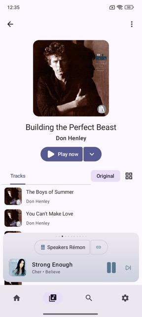
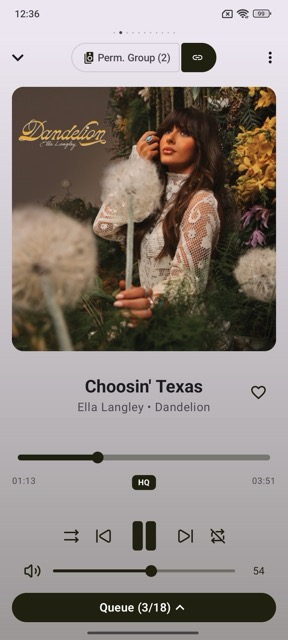
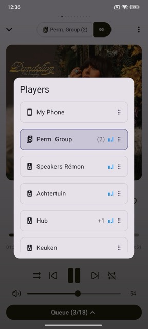
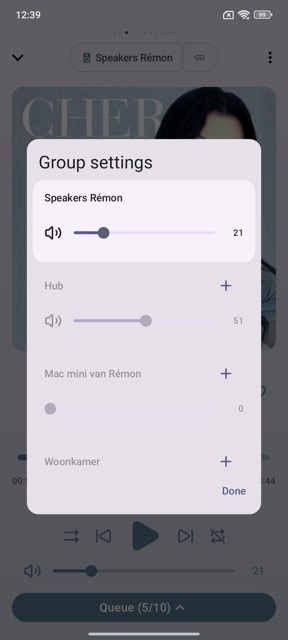
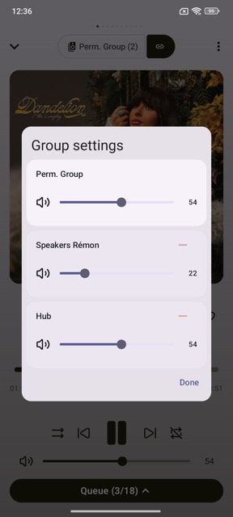
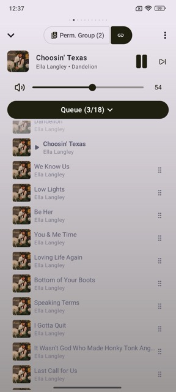
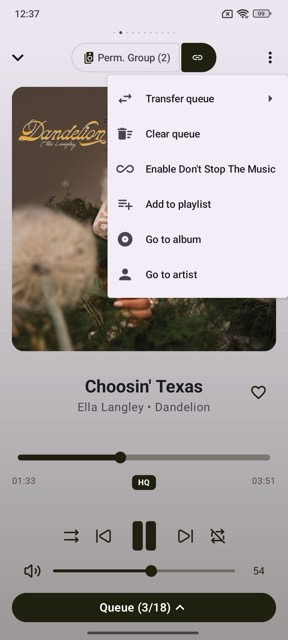

# Players Pager

The Players Pager is always visible, and it works independently of the rest of the app. It always shows the player or the group that you control, on every screen.

## Views

The pager has two states. You can move between them at any time.

### Compacted View
A slim bar at the bottom of the screen. It shows the name of the active player, the grouping control and the most important playback controls. Swipe left or right to change to a different player.

### Expanded View
The full-screen player. It shows the artwork, the media information, the status badges, the playback controls and the volume control. Swipe left or right to change to a different player.

> Tap the compacted player bar to open the expanded view. Swipe down on the artwork to go back to the compacted view.

## Players List

Tap the **player name** in either view to open the Players list.

In the Players list, you can do these actions:

- **Change** to a player or a group. Tap it. The list highlights the active player.
- **Reorder** the players and the groups. Drag the **⠿ six-dot handle** on the right of a row up or down. You swipe through the players in this order.
- **Hide** the players that are not available. Open the **⋮ (three-dot) menu** and tap **Hide unavailable**. Tap it again to show them.

## Group Settings

Tap the **group icon** next to the player name to open **Group settings**. The sheet shows the selected player first, and then the players that can join it.

- Select the checkbox of a player to add it to the group.
- Clear the checkbox of a player to remove it from the group.
- Clear the checkbox of the group leader to remove the leader. The server then moves the queue to a different member. Playback continues from the same position. If no other member stays, the group dissolves and playback stops. The checkbox of the leader is available only if the server is new enough.
- Tap the **volume button** of a player to show its volume slider. For a permanent group, the slider on the first row sets the volume of the full group.
- Tap the **delay button** of a player to change its playback delay. Refer to [Player Delay](#player-delay).

The sheet shows the buttons only for the players in the group.

### Permanent Groups

Permanent groups are Music Assistant Group Players that you configure on the server. You cannot create them in the app. But you can change their volume and the volume of each member in **Group settings**.

### Player Delay

The delay button shows only for a Sendspin player, for example the [Local Player](local-sendspin-player-settings.md) of this phone. Use it if the players in a group do not play at the same time.

- **Speed up** makes the player play earlier.
- **Slow down** makes the player play later.

Tap **1 ms**, **10 ms** or **100 ms** to change the delay by that value. The change applies immediately, and playback does not stop. For a Sendspin player other than this phone, the delay button shows only if you have the `config.players.write` scope.

## Gestures

### Compacted view

| Gesture | Action |
|---|---|
| Swipe left or right | Change to the previous or the next player or group |
| Tap | Open the expanded player view |

### Expanded view

| Gesture | Action |
|---|---|
| Swipe left or right | Change to the previous or the next player or group |
| Swipe up from the track title | Open the queue |
| Swipe down on the artwork | Close the expanded view and go back to the compacted view |
| Tap the artist line below the track title | Open the artist. If the track has more than one artist, select the artist in the dialog. |

### Queue

| Gesture | Action |
|---|---|
| Tap the Queue bar | Open the queue |
| Swipe down on the queue | Close the queue |

## Status Badges

The expanded view shows a row of badges above the artwork. Tap a badge to change its setting. A badge is dimmed if you cannot change it at that time.

| Badge | Description |
|---|---|
| **Sleep timer** | Opens the **Sleep timer** dialog. Select a time from 15 minutes to 2 hours. A newer server also lets you stop at the end of the current item or chapter. Tap **Clear timer** to stop the timer. The badge shows the time that is left. |
| **Autoplay** | Turns Autoplay on or off. When the queue ends, Autoplay adds similar music. On server 2.11 or later, Autoplay is off while repeat is on. |
| **Crossfade** | Turns crossfade between tracks on or off. |

A badge shows only if the server supports its feature.

## Track Information

Below the progress bar, the expanded view can show these items:

- **Quality badge** (**LQ**, **SQ**, **HQ** or **HR**): Tap it to open the **Audio chain** dialog. The dialog shows the input and the output format of the stream. On server 2.11 or later, it also shows the container that the item plays from, for example an album or a playlist. Tap the container to open it.
- **Playback speed**: For an audiobook or a podcast episode, the speed shows instead of the quality badge, for example `1.25x`. Tap it to open the **Playback speed** dialog. Select a speed from 0.5x to 3x.
- **Ambient sound**: Shows while an ambient sound plays with the queue. Tap it to change the ambient sound.

If the current track has lyrics, tap the **lyrics button** next to the title to show the lyrics. For a podcast episode, the same button shows the transcript, on server 2.11 or later.

## Volume Control

The expanded view shows a volume slider for a player that supports volume control.

- **Drag** the volume bar to change the volume continuously.
- **Tap left or right** of the slider position to decrease or increase the volume in small steps.
- **Tap the speaker icon** to mute or unmute the player. This works only if the player supports mute.

### Hardware Volume Buttons

On iPhone, the volume buttons change the volume of the phone only.

On Android, you can let the volume buttons control the selected player:

1. Open **Settings**.
2. In the **Misc** section, select **Volume buttons control the selected player**.

Then the volume buttons change the volume of the selected player while the app is open. If this phone is the selected player, or if the setting is off, the volume buttons change the volume of the phone.

## Queue

The queue bar shows your position in the queue, for example `Queue (3/18)`.

- Swipe up from the title area or tap the queue bar to open the queue.
- Tap a track in the queue to play it immediately.
- Swipe down on the queue to close it.

When the queue plays to its end, the queue shows all items as played and shows **Playback finished**.

### Audiobooks

For audiobooks, the progress bar shows the time and the chapter markers. The queue shows the **chapter list** instead of the tracks. Tap a chapter to go to it.

## Three-Dot Menu (⋮)

The ⋮ menu in the expanded view shows the options that apply to the player and to the current item.

| Option | Description |
|---|---|
| **Power on**, **Power off** | Turns the player on or off. Shows only if the player supports power control. |
| **Transfer queue** | Moves the queue to a different player or group. Shows only if the queue has items. |
| **Clear queue** | Clears the queue and stops playback. Shows only if the queue has items. |
| **Enable AI Radio DJ** | Refer to [AI Radio DJ](#ai-radio-dj). |
| **Play announcement** | Refer to [Play announcement](#play-announcement). |
| **Ambient sound** | Refer to [Ambient sound](#ambient-sound). |
| **DSP settings** | Opens the DSP settings of the player. Shows only for a player that is not a group, and only if you have the `config.players.write` scope. |
| **Dynamic colors** | Turns on or off the player colors that come from the artwork. |
| **Show buffer indicator** | Shows the buffered audio on the progress bar. Shows only for the Local Player. |
| **Show waveform** | Shows the waveform of the track on the progress bar. Shows only for a track, and only on a server that supports waveforms. |
| **Add to playlist** | Adds the current track to a playlist. Needs the `library.write` scope. |
| **Copy play link** | Copies a link that plays the current item on this player. Refer to [Copy a Play Link](deep-links.md#copy-a-play-link). |
| **Go to album**, **Go to artist**, **Go to podcast** | Opens the album, the artist or the podcast of the current item. |

### AI Radio DJ

Use **Enable AI Radio DJ** to add an AI Radio host to the queue. The host speaks between the tracks. The option shows only if these conditions are true:

- The server has the AI Radio plugin.
- The server has schema version 88 or higher.
- Your user role has the `config.providers.read` scope and the `queues.control` scope.

Select a host to start the DJ or to change the host. Select **Off** to stop the DJ. A check mark shows the current selection. The menu updates when a different app changes the DJ.

You can change the host while an AI Radio show plays on the queue. Use the Music Assistant web app to create and edit hosts.

### Play announcement

Use **Play announcement** to speak a message on the player. The player stops or lowers its music, plays the message, and then continues.

- **Type**: Write the message. The server speaks it with its text-to-speech engine. The tab shows only if the server has a text-to-speech engine.
- **Speak**: Push and hold the microphone button, then speak. Release the button to send the message. The tab shows only on a server with schema version 48 or higher. The tab does not show for the player on this phone.
- **Play chime first**: Plays a short sound before the message. The switch starts with the setting of the player.
- **Custom volume**: Turn on the switch to set the volume of the message with the slider. If the switch is off, the player uses its own announcement volume. The server keeps the volume between the minimum and the maximum announcement volume of the player.

The app asks for the microphone permission at the first push of the button. If you refused the permission, use **Open settings** to turn it on. The message plays after you release the button, so you can close the dialog at once.

### Ambient sound

Use **Ambient sound** to play a sound effect in a loop together with the music. All players that play the queue hear the sound. The option shows only if a music provider on the server supports sound effects.

1. Select a sound, or select **Off**.
2. Move the **Relative volume** slider. At 100%, the sound is as loud as the music.
3. Tap **Apply**.

While the sound plays, the menu option shows the sound name and the volume.

## Favoriting

Tap the **♡ heart icon** next to the track title to add the current item to your favorites. Tap it again to remove it. You need the `library.write` scope.

## Playback Controls

Both views show the playback controls. The compacted view shows fewer controls. Play and pause and skip to next are always visible.

The expanded view shows the full control row:

| Control | Description |
|---|---|
| **⏮ Previous** | Go to the previous track |
| **⏭ Next** | Skip to the next track |
| **⏸ Play / Pause** | Start or pause playback. For content that cannot pause, for example a live stream, the button stops playback. |
| **⇄ Shuffle** | Turn shuffle on or off. A different icon shows when smart shuffle is on. |
| **↺ Repeat** | Change the repeat mode |

For an audiobook or a podcast episode, **Rewind 10s** and **Forward 30s** show instead of **Shuffle** and **Repeat**.

While a play request runs, a ring turns around the play button. The ring also shows when a different app starts playback on the same queue.
