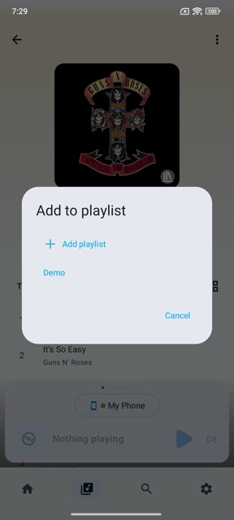
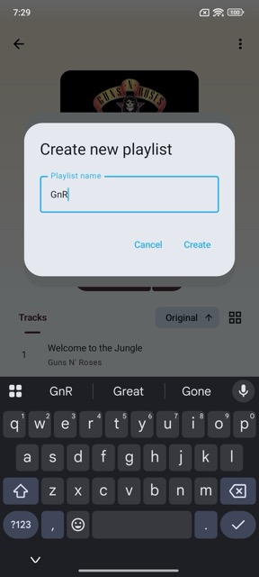

# Managing Playlists

> **Note:** You cannot create or configure Smart Playlists in the Mobile App. But you can delete a Smart Playlist in the app.

You can add an item to a **playlist** from the long-press menu, or from the **⋮ (three-dot) menu** in the item details page or the player. You can create a new playlist in the **Playlists** library list, or in the **Add to playlist** dialog.

The actions on this page that change a playlist need the `library.write` scope.

## Adding an Item to a Playlist

When you add an item to a playlist, you can select any editable playlist in your library.

## Creating a New Playlist

In the **Add to playlist** dialog, select **Add playlist** to open the dialog that creates a new playlist. In the **Playlists** list, tap **Add new**.

The app always creates a playlist on the **Music Assistant** built-in source. So one playlist can contain items from many music sources. For example, it can contain items from **Spotify**, **Tidal** and a local library on an **SMB/CIFS** or **NFS** share.

## Playlist Access

A playlist page shows the owner of the playlist under the title. From server 2.11, a Music Assistant playlist shows its access instead:

- **Personal**, or the name of the owner.
- The users that can see the playlist, for example **Only me** or **Everyone, including guests**.
- **Collaborative**, if other users can edit the playlist.

## Removing Items from a Playlist

You can remove many items from a playlist at the same time.

1. Open a playlist that you can edit.
2. Long-press a track.
3. Tap **Select multiple**.
4. Tap the other tracks that you want to remove.
5. Tap **Actions for selected items** in the top bar.
6. Tap **Remove from playlist**.
7. Tap **Remove** to confirm.

> **Note:** Spotify removes a track by its link. If a Spotify playlist contains a track more than one time, Spotify removes all copies of the track.

For more about the selection, refer to [Selecting Multiple Items](item-details.md#selecting-multiple-items).

## Importing a Playlist

You can import an M3U playlist file (`.m3u` or `.m3u8`).

1. Open the **Playlists** list in the library.
2. Tap **Import**.
3. Select the playlist file.
4. In the **Import playlist** dialog, select the music sources in **Search for tracks on**.
5. Select an option in **Track matching**.
6. Tap **Import**.

The file must start with the `#EXTM3U` header. The maximum file size is 3 MiB.

**Search for tracks on** lists your music sources that the server can search. The server uses the selected sources if the original source of a track is not available.

**Track matching** shows only on server 2.11 or later. Select one of these options:

| Option | Result |
|---|---|
| **Exact release** | Matches a track with the same release only. |
| **Same recording (recommended)** | Matches the exact track first. If it is not found, matches the same recording from a different release. |
| **Best effort** | Matches the exact track first, then the same recording. If both are not found, accepts the closest match. |

The server matches the tracks after the import starts. The new playlist shows in the list, and the server adds the tracks to it after some time.

## Exporting a Playlist

You can export a playlist in your library as an M3U file.

1. Open the playlist.
2. Open the **⋮ (three-dot) menu**.
3. Tap **Export playlist**.
4. In the share sheet, select where to send the file.

The app makes a `.m3u8` file. The server exports a playlist in your library only, so the action does not show for other playlists.
