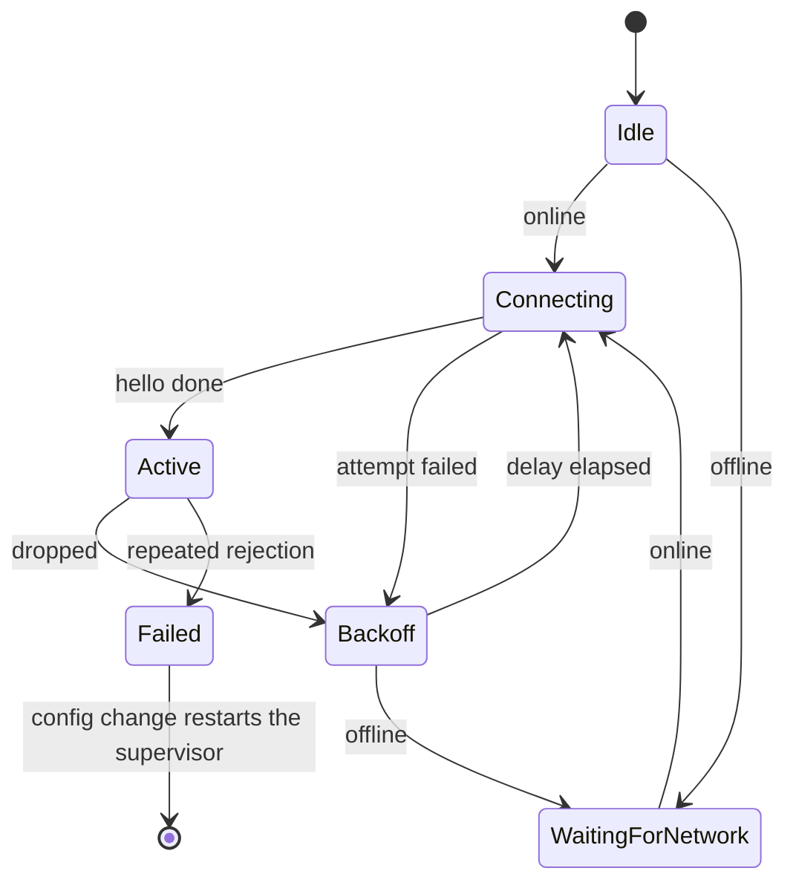

# Sendspin local player

The `:sendspin-kmp` module is a Sendspin client for the `player@v1` role. It connects to a Sendspin
server, keeps an encrypted session, and follows the server clock. It plays the audio stream in
time with the other players in a group. The connection is always encrypted: there is no
plaintext session.

The module is a pure Kotlin Multiplatform leaf. It depends on no other Gradle project. It
contains no Compose code and no Koin code. Each platform difference is an interface that the
application implements, with one exception. The X25519 backend is an `expect`/`actual`
declaration, because the Android platform JCA has X25519 only from API 33.

This file documents the module from the outside, as a client of it sees it. Each package
documents its own rules in KDoc next to the code. The cryptography, the specification mapping,
and the test vectors are in
[`noise/README.md`](src/commonMain/kotlin/io/music_assistant/sendspin/noise/README.md).

## Scope

The module does this work:

- Transport, Noise encryption, and the session state machine.
- Client identity, trust records, and pairing.
- Server clock synchronization.
- Audio buffering, decode dispatch, and output scheduling.

The module does not do this work:

- **No control plane.** Play, pause, seek, and queue commands go over the control API of the
  server, in the application. The module sends `player@v1` messages only.
- **No WebRTC.** For a data-channel connection the application supplies
  `Endpoint.WebRtc(openChannel)`, and the module calls it once per attempt.
- **No iOS audio.** `AudioSink` and `DecoderFactory` are ports. The module includes Android
  implementations of them, see [Android ports](#android-ports). An iOS application implements
  them itself.
- **No settings and no text.** The module never writes application settings and holds no
  user-facing string. It reports codes, and the application maps them to resources.

## Design goals

1. One owner per piece of state.
2. One reconnect policy, in one pure object.
3. Bounded queues everywhere. Nothing on the audio path grows without a limit.
4. Structured concurrency. Cancellation is the only teardown.
5. The audio pipeline outlives the connection, so buffered audio drains through a reconnect.
6. A small public surface, enforced by `internal` and checked by the compiler.

## Consume the library

The library is in the GitHub Packages Maven registry of the `music-assistant/mobile-app`
repository. The coordinate is `io.github.music-assistant:sendspin-kmp`. GitHub Packages needs a
token for each download, also for a public repository.

1. Make a GitHub personal access token (classic) with the `read:packages` scope.
2. Put your GitHub user name and the token in `~/.gradle/gradle.properties`:

   ```properties
   gpr.user=<github-user>
   gpr.key=<token>
   ```

3. Add the repository to `settings.gradle.kts`:

   ```kotlin
   dependencyResolutionManagement {
       repositories {
           maven("https://maven.pkg.github.com/music-assistant/mobile-app") {
               credentials {
                   username = providers.gradleProperty("gpr.user").orNull
                   password = providers.gradleProperty("gpr.key").orNull
               }
               content { includeGroup("io.github.music-assistant") }
           }
       }
   }
   ```

4. Add the dependency. In a Kotlin Multiplatform project, add it to `commonMain`. In an Android
   project, add it to `dependencies`. Gradle selects the Android variant, an AAR.

   ```kotlin
   implementation("io.github.music-assistant:sendspin-kmp:0.1.0")
   ```

### Android quick start

This code builds a player from the [Android ports](#android-ports). It needs a Ktor engine, for
example `io.ktor:ktor-client-okhttp`.

```kotlin
val scope = MainScope()
val config = MutableStateFlow<LocalPlayerConfig?>(
    LocalPlayerConfig(
        endpoint = Endpoint.WebSocket("ws://192.168.1.10:8927/sendspin", WireVersion.SPEC_1_0),
        deviceName = "Kitchen phone",
        codecPreference = listOf(AudioCodec.FLAC, AudioCodec.OPUS),
        bufferSeconds = 5,
        userDelayMs = 0,
    ),
)
val deps = SendspinDeps(
    sink = AudioTrackSink(context, ElapsedRealtimeClock),
    decoders = AndroidDecoderFactory(),
    keyStore = SharedPreferencesSendspinKeyStore(context),
    httpClient = HttpClient(OkHttp),
    online = connectivityOnline(context, scope),
    approvePairing = {},
    audioDispatcher = sendspinAudioDispatcher(),
    deviceInfo = DeviceInfo(productName = "My Player", manufacturer = "Example", softwareVersion = "1.0"),
    clock = ElapsedRealtimeClock,
)
val player = SendspinPlayer(config, deps, scope)
```

Set the config to `null` to stop the player.

### Versions

- **Kotlin.** The library compiles with Kotlin 2.4 at language and API version 2.3. An Android
  consumer needs Kotlin 2.3 or newer. An iOS consumer must use the same Kotlin version as the
  library, because klib compatibility across Kotlin versions is not checked.
- **Dependencies.** The library brings Ktor 3.5.2, kotlinx-coroutines 1.11.0, and Kermit 2.1.0.
  It brings no Ktor engine.
- **Changes.** [`CHANGELOG.md`](CHANGELOG.md) lists the changes of each version.

### Public API changes

The file `api/sendspin-kmp.klib.api` holds the public API of the library. The
`checkKotlinAbi` task compares the code with this file, and the iOS pull request check runs it.
The file comes from the iOS klibs, so it covers `commonMain` only. It does not cover the
[Android ports](#android-ports).

To change the public API on purpose:

1. Run `./gradlew :sendspin-kmp:updateKotlinAbi` on macOS.
2. Commit the changed `api/sendspin-kmp.klib.api` file with the code.
3. Add the change to `CHANGELOG.md`.

A new `SendspinDeps` parameter with a default value keeps the source compatible. But it changes
the constructor, so code that compiled against the old version breaks. Increase the minor
version for this change, and write it in the changelog.

### Publish a version

The `sendspin-release.yml` workflow runs the module tests and the public API check. Then it
runs the consumer check. Then it publishes the version, pushes the tag `sendspin-v<version>`, and
creates the GitHub Release. At the end, it opens a draft PR that increases the minor version.

The consumer check is the standalone Gradle project in [`consumer-check/`](consumer-check). It is
an Android application with Kotlin 2.3, the oldest Kotlin that an Android consumer can use. The
workflow publishes the library to `mavenLocal`, and then the application compiles the
[Android quick start](#android-quick-start) against it. R8 shrinks the release build. The check
stops if the library code that the application uses refers to a missing class. The check also
stops if the merged manifest has no `INTERNET` or `ACCESS_NETWORK_STATE` permission. If you
change the quick start, make the same change in `ConsumerCheckApplication.kt`. The Android pull
request check also runs the consumer check, so a pull request shows a break before the release.

To run the consumer check on your computer, run these commands from the repository root:

```bash
./gradlew :sendspin-kmp:publishToMavenLocal
./gradlew -p sendspin-kmp/consumer-check :app:compileDebugKotlin :app:minifyReleaseWithR8 :app:checkReleasePermissions -PsendspinVersion=<version>
```

1. Make sure that `sendspinVersion` in the root `gradle.properties` is the version to publish.
2. Write the changes in the `## <version>` section of `CHANGELOG.md`. The workflow stops if
   this section is empty.
3. Start the workflow. Add the `sendspin_release` label to a PR and merge the PR into `main`,
   or start the workflow manually.
4. Merge the version bump PR. It also adds an empty section for the next version to
   `CHANGELOG.md`, and it sets the dependency line in this README to the released version.

The workflow stops if the tag exists, because GitHub Packages refuses a second upload of a
version. For a patch release, change the version in the bump PR before you merge it.

If a run fails after the upload, start the workflow again before you merge other changes into
`main`. The new run continues the release:

- It skips the upload when GitHub Packages already has all publications of the version.
- It keeps the tag if the tag is on the same commit, and it updates the GitHub Release.
- It keeps the version bump branch if the branch exists.

If GitHub Packages has only some publications of the version, the workflow stops. Then delete
that version of each `sendspin-kmp` package in the package settings, and start the workflow
again. If the tag is on a different commit, the workflow stops, because `main` changed after the
first run.

## Use the module

### Entry point

One function creates the player. It is the only public function outside the `api` package.

```kotlin
fun SendspinPlayer(
    config: StateFlow<LocalPlayerConfig?>,
    deps: SendspinDeps,
    scope: CoroutineScope,
): SendspinPlayer
```

The player runs for the life of `scope`. It has no `start` and no `stop`: a `null` config
disables it, and that is the only stop.

The package `io.music_assistant.sendspin.api` plus this factory are the whole public surface.
Every other declaration in the module is `internal`, so the compiler rejects a leak into the
application. The module compiles in explicit API mode, so each public declaration has an
explicit `public` modifier.

### Configuration

`LocalPlayerConfig` has two classes of field: ones that cause a reconnection when they change,
and ones that do not.

| Field | Causes reconnect? | Effect of a change |
| --- | --- | --- |
| `endpoint` | Yes | Restarts the connection. The audio pipeline is untouched. |
| `deviceName` | Yes | Restarts the connection. |
| `codecPreference` | Yes | Restarts the connection. |
| `bitDepth` | Yes | Restarts the connection. |
| `bufferSeconds` | Yes | Restarts the connection, because the server reads `buffer_capacity` only from the hello. |
| `userDelayMs` | No | Applies to the next scheduled chunk. |

Clients should keep the same `Endpoint` instance while the endpoint did not change.
`Endpoint.WebRtc` compares by identity, so a new instance restarts the connection.

### Ports the application implements

| Port | Purpose |
| --- | --- |
| `AudioSink` | Platform audio output. `open` builds a new device stream each time. |
| `DecoderFactory` | Creates one `AudioDecoder` for a codec. |
| `SendspinKeyStore` | Byte-blob storage for identity and trust. Reads never throw. |
| `SendspinTransport` | Frames over one WebRTC data channel. |

`SendspinDeps` also takes the application's `HttpClient`, an `online` flow, an `approvePairing`
call, the audio dispatcher, the `DeviceInfo` for `client/hello`, and an optional clock.

A decoder can be a **pass-through**: it returns `outputCodec != PCM`, and the sink decodes the
bytes itself. iOS works this way. The scheduler then treats the bytes as opaque. It cannot trim,
pad, or resample them, so it schedules open loop. See the KDoc on `Scheduler`.

### Android ports

On Android, the package `io.music_assistant.sendspin.android` has an implementation for most
fields of `SendspinDeps`.

| `SendspinDeps` field | Android implementation |
| --- | --- |
| `sink` | `AudioTrackSink(context, clock)` |
| `decoders` | `AndroidDecoderFactory()`: MediaCodec for FLAC, Concentus for Opus, and PCM. |
| `keyStore` | `SharedPreferencesSendspinKeyStore(context)` |
| `online` | `connectivityOnline(context, scope)` |
| `audioDispatcher` | `sendspinAudioDispatcher()` |
| `clock` | `ElapsedRealtimeClock` |

Give the same clock to `AudioTrackSink` and to `SendspinDeps.clock`. The application supplies
`httpClient`, `approvePairing`, and `deviceInfo`. The module depends on `ktor-client-core` only,
so add a Ktor engine to the application, for example `ktor-client-okhttp`.

The module manifest declares `INTERNET` and `ACCESS_NETWORK_STATE`, and Gradle merges them into
the application manifest. The AAR also contains the R8 rules of the module. The application owns
the foreground service and the media session.

The Android implementations use the `api` package only. No code in `commonMain` uses them.

### Authentication and pairing

The module holds no credential of its own. It can need two things from the application.

**`Endpoint.WebSocket` can carry a token for an authenticating proxy.** A server can put the
Sendspin server behind the same authenticated reverse proxy as its control socket. Then a client
needs one open port and one credential. With a token, the module sends `auth` and waits for
`auth_ok` before the Sendspin protocol starts. This exchange belongs to the proxy, not to
Sendspin. Without a token, the Sendspin protocol starts at once. A WebRTC data channel never
sends `auth`, because the channel is already proven.

**`approvePairing` pairs the player without a person.** A Sendspin server does not accept an
unknown player on its own. It shows a pairing code, and a person approves the code. A Sendspin
server also accepts a pairing token that arrives over a channel it already trusts. That second
route needs no person.

The module mints the token, but it cannot deliver it. It speaks one protocol on one socket, and
it holds no control plane. So it gives the token to the application, and the application gets
the token approved. The module asks when a session comes up unpaired. The module asks again
after a server-side unpair, so the player returns on the next reconnect.

An application that pairs by the code supplies an `approvePairing` that does nothing.

### State and events

`state` is a `StateFlow<PlayerState>`.

| State | Meaning |
| --- | --- |
| `Disabled` | The config is `null`. |
| `Connecting(attempt)` | An attempt is in progress. |
| `Connected(...)` | The session is up. Carries the player id, the server name, the clock quality, and the audio status. |
| `Reconnecting(...)` | The connection dropped and a retry is scheduled. `nextRetryAtMs` is `null` while the module waits for the network. |
| `Failed(cause)` | The module gave up. It leaves this state only on a config change. |

`events` is a buffered `Flow<PlayerEvent>`. A slow collector loses the oldest event.

| Event | The application must |
| --- | --- |
| `PlaybackStarted` | Nothing. The first audio reached the sink. |
| `PlaybackStopped(cause)` | Nothing. Show the cause if it helps the user. |
| `ServerRefreshNeeded` | Refetch the player list. The server assigned or changed the player id. |
| `FocusRegained` | Resume playback if the user wants it. |
| `Warning(code)` | Show a notice. The module already recovered or degraded. |

## Connection lifecycle



`ConnectionSupervisor` runs one attempt at a time. Every attempt ends with a `DropReason`, and
`ReconnectPolicy` turns it into one of three decisions: retry after a delay, wait for the
network, or fail. Only repeated rejections can fail, because the first rejections are expected
while the pairing call is still in flight. The backoff is exponential with jitter and a cap, and
it is unlimited while the device is online.

Offline is not a timer. The supervisor waits on the `online` flow and attempts again at once when
the network returns.

A reconnect does not stop the audio. The pipeline outlives the connection, so audio that is
already buffered keeps playing, and a stream that resumes in the same format is not rebuilt.

## Known limitations

- **No volume or mute commands.** The player sends an empty `supported_commands` list. It
  ignores each `server/command` message. Control the volume through the control plane of the
  application.
- **Silent pairing is the only pairing route.** If the server waits for a person to approve a
  pairing code, the server rejects each attempt with `pairing_required`. After 5 rejections in a
  row, the player goes to `Failed(Unauthorized)`. To try again, set the config to `null` and then
  set it again.
- **One stream shape.** The player advertises stereo at 48 kHz only. FLAC and PCM can be 16-bit
  or 24-bit. Opus is always 16-bit.
- **No server discovery.** The module does not find servers on the network. The application
  supplies the endpoint.
- **Kotlin API only.** The public API uses coroutines, `StateFlow`, and sealed types. The module
  has no Swift API and no XCFramework. An iOS application calls the module from Kotlin code.

## Logging

The module writes its logs through the global Kermit `Logger`, with one tag for each component.
It does not take a logger as a dependency. To filter or redirect the logs, configure Kermit in
the application:

```kotlin
Logger.setMinSeverity(Severity.Warn)
Logger.setLogWriters(listOf(myLogWriter))
```

This configuration also applies to all other Kermit logs of the application.

## Integration with Music Assistant

Music Assistant hosts a Sendspin server. The Music Assistant application uses the module in this
way:

- **Endpoint.** The default URL is the Music Assistant socket at `<server>/sendspin`. The token
  in `Endpoint.WebSocket` is the Music Assistant access token. Over Remote Access, the
  application opens a data channel on its WebRTC peer connection.
- **Device info.** The application reports the product name "Mobile Application", the
  manufacturer "Music Assistant", and the application version.
- **Pairing.** `approvePairing` sends the token in the `sendspin/pair_web_player` command over
  the API connection of the application.
- **Encryption.** The encrypted protocol needs Music Assistant schema 45 or newer. For a server
  with a lower schema, the application gives `Endpoint.Unsupported`.
- **Wire version.** `sendspinWireFor` in the application selects the `WireVersion` from the
  schema and the server version:

| Music Assistant server | aiosendspin | `WireVersion` |
| --- | --- | --- |
| 2.10.6 and older | 9.x | `LEGACY_9` |
| 2.10.7 and 2.11 | 10.x | `SPEC_1_0` |

An unknown server and a source build get `LEGACY_9`. The handshake does not give the server
version, so the application reads it from the Music Assistant API.
